# التحليل والتصميم: حالات الاستخدام والمخططات

**المرحلة:** 20–27 أكتوبر 2026 (مرحلة التحليل والتصميم حسب القسم 7 من المرجع)
**المرجع:** `graduation_project_master_reference.md`، `system_architecture.md`، `schema.sql`
**الحالة:** مسودة للمراجعة الداخلية. تُعرض المخططات كنص Mermaid، ويمكن لصقها في mermaid.live لرؤيتها كصور.

---

## 1. الفاعلون (Actors)

| الفاعل | الوصف | الصلاحية |
|---|---|---|
| **المالك** | صاحب المنزل، المستخدم الأساسي | كاملة على مشاريعه |
| **عضو المشروع** | أحد أفراد الأسرة أو الشريك المشارك في الإدخال | تحدده المالك (إدخال، أو قراءة) |
| **المستلم بالمشاركة** | مهندس أو مقاول يطّلع عبر رابط مؤقت | قراءة فقط، ضمن نطاق التقرير |
| **المراجع الهندسي** | مهندس يراجع قوائم الفحص وقاعدة المعرفة | قراءة قاعدة المعرفة وتعليق كتابي خارج النظام |
| **جدولة n8n** | نظام آلي يرسل التقرير الأسبوعي | قراءة عرض `weekly_report_v` فقط |
| **المساعد الذكي** | يشرح المراحل والحسابات | قراءة فقط من قاعدة المعرفة المعتمدة وبيانات المالك |
| **مدير النظام** | يفعل الميزات ويراقب الأعطال | إعدادات `feature_flags` وسجلات التدقيق |

---

## 2. كتالوج حالات الاستخدام

| الرقم | حالة الاستخدام | الفاعل الرئيسي | الميزة | الأولوية |
|---|---|---|---|---|
| UC-01 | التسجيل وتسجيل الدخول | المالك | 3.11 | 0 |
| UC-02 | إنشاء مشروع وتحديد نوعه (جديد أو إضافة طابق) | المالك | 3.1 | 0 |
| UC-03 | إدارة المراحل (تاريخ مخطط وفعلي وحالة) | المالك | 3.1 | 0 |
| UC-04 | إدارة المهام | المالك، عضو | 3.1 | 0 |
| UC-05 | دعوة عضو وتحديد صلاحيته | المالك | 3.11 | 0 |
| UC-06 | تحديد الميزانية وبنود الطوارئ | المالك | 3.2 | 0 |
| UC-07 | تسجيل مصروف سريع (3 نقرات وصورة فاتورة) | المالك، عضو | 3.19 | 0 |
| UC-08 | تسجيل مصروف بعملة أجنبية وسعر صرف مرجعي | المالك | 3.18 | 1 |
| UC-09 | إدخال جدول الكميات مرة واحدة | المالك، المراجع | 3.9 | 2 |
| UC-10 | تسجيل شراء مادة وربطه بالكمية المخططة | المالك، عضو | 3.9 | 1 |
| UC-11 | تسجيل سعر أو عرض سعر لمادة | المالك | 3.10 | 2 |
| UC-12 | حساب كميات الحديد من جدول التفريد | المالك | 3.3 | 1 |
| UC-13 | مقارنة الاستمرار بالتوقف المؤقت | المالك | 3.7 | 1 |
| UC-14 | رفع صورة موثّقة بزاوية وربطها بمرحلة | المالك، عضو | 3.8 | 4 |
| UC-15 | إضافة وثيقة أو عقد أو تصريح | المالك | 3.4 | 0 |
| UC-16 | تسجيل دفعة مرتبطة بمرحلة وعقد | المالك | 3.16 | 1 |
| UC-17 | تسجيل أعمال إضافية وأثرها على الميزانية | المالك | 3.16 | 1 |
| UC-18 | تشغيل قائمة فحص قبل الصب أو التغطية | المالك، المراجع | 3.12 | 2 |
| UC-19 | تسجيل خرسانة (تاريخ الصب، المورد، الكمية) | المالك | 3.13 | 2 |
| UC-20 | الإبلاغ عن عيب بصورة وموقع ومسؤول | المالك، عضو | 3.17 | 2 |
| UC-21 | إنهاء مرحلة عبر قائمة التسليم والجرد الختامي | المالك | 3.23 | 2 |
| UC-22 | التحقق من بوابة الجاهزية قبل البدء | المالك | 3.15 | 2 |
| UC-23 | تحديد نقاط التوقف الآمنة لمرحلة | المالك | 3.14 | 2 |
| UC-24 | تطبيق حزمة أعمال تشطيب على مرحلة | المالك | 3.22 | 2 |
| UC-25 | طلب شرح مرحلة من المساعد | المالك، عضو | 3.6 | 3 |
| UC-26 | تفعيل التقرير الأسبوعي وتحديد يومه وقناته | المالك | 3.21 | 3 |
| UC-27 | استلام التقرير الأسبوعي | المالك، المستلم | 3.21 | 3 |
| UC-28 | مشاركة تقرير بالقراءة فقط برابط مؤقت | المالك | 3.11 | 2 |
| UC-29 | عرض لوحة التحكم | الكل حسب الصلاحية | 3.5 | 0 |
| UC-30 | مراجعة قاعدة المعرفة الهندسية | المراجع الهندسي | 3.6 | 3 |
| UC-31 | تعطيل ميزة أو تفعيلها | مدير النظام | 5 | 0 |
| UC-32 | تسجيل العمل بلا اتصال ومزامنته | المالك، عضو | 3.20 | 3 |

**ملاحظة على UC-14:** صنّفنا تحليل الصور بالذكاء الاصطناعي كمستبعد، لذلك UC-14 توثيق منظم بزوايا محددة فقط.

---

## 3. مخطط حالات الاستخدام (الفاعلون والحالات الرئيسية)

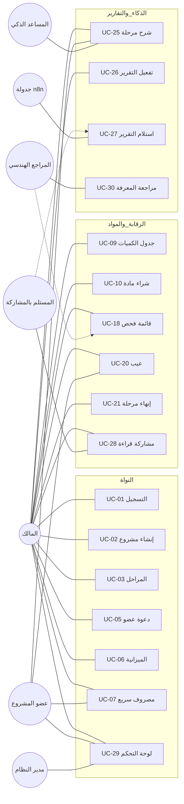

---

## 4. مخططات الأنشطة للإجراءات الحرجة

### 4.1 الإدخال السريع للمصروف (UC-07)

> **التصميم الهدف (أكتوبر).** النسخة المبنية، دون عمل بلا اتصال، في القسم 13.2.

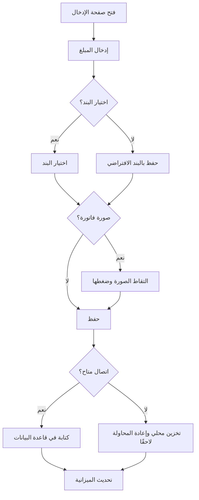

### 4.2 إنهاء مرحلة (UC-21، إعادة تصميم وفق 3.23)

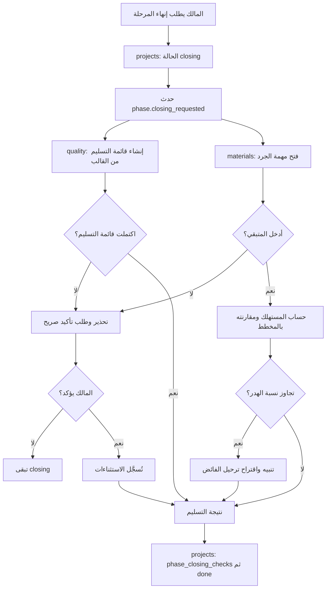

### 4.3 بوابة الجاهزية قبل البدء (UC-22)

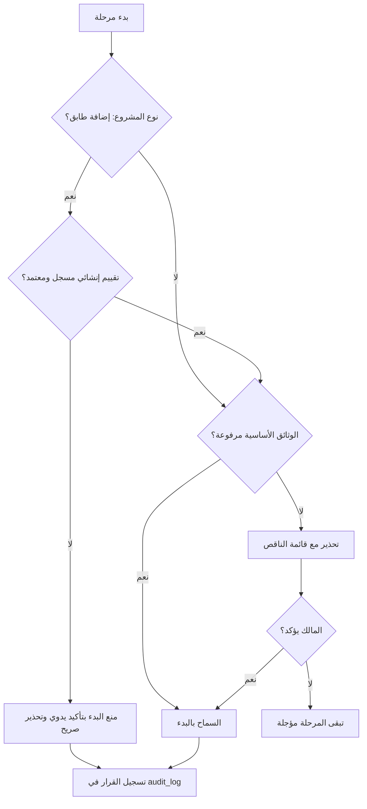

### 4.4 التقرير الأسبوعي عبر n8n (UC-27)

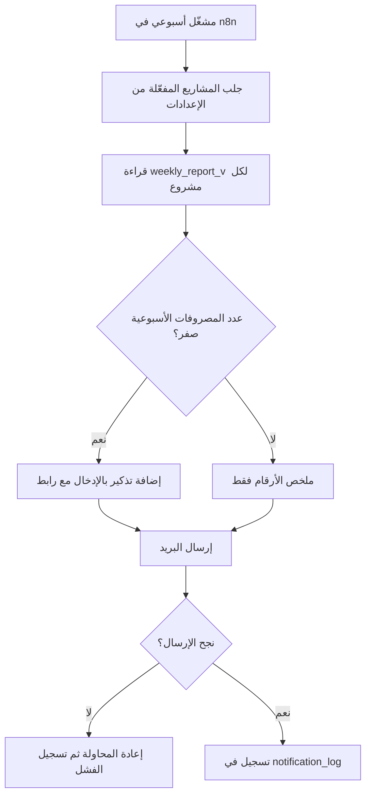

---

## 5. مخطط الكيانات والعلاقات (ERD) — الإصدار 2

يعكس التعديلات في القسم 13 من `system_architecture.md`: عضوية المشروع، والحالة `closing`، وجرد المواد، وإزالة مفتاح `purchases.expense_id`، والجداول التقنية (outbox وaudit وfeature_flags). يرمز `ref` إلى مرجع ضعيف (معرّف بلا مفتاح خارجي) عبر الوحدات.

```mermaid
erDiagram
  PROFILES ||--o{ PROJECT_MEMBERS : "عضوية"
  PROJECTS ||--o{ PROJECT_MEMBERS : "يضم"
  PROJECTS ||--o{ PHASES : "يتكون من"
  PROJECTS ||--o{ TASKS : "يحوي"
  PROJECTS ||--o{ BUDGET_CATEGORIES : "ميزانية"
  PROJECTS ||--o{ EXPENSES : "مصروفات"
  PROJECTS ||--o{ EXCHANGE_RATES : "أسعار صرف"
  PROJECTS ||--o{ QUANTITY_ITEMS : "كميات"
  PROJECTS ||--o{ PRICE_RECORDS : "أسعار"
  PROJECTS ||--o{ PHOTOS : "صور"
  PROJECTS ||--o{ CONTRACTS : "عقود"
  PROJECTS ||--o{ CHECKLISTS : "قوائم فحص"
  PROJECTS ||--o{ ISSUES : "عيوب"
  PROJECTS ||--o{ DOCUMENTS : "وثائق"
  PROJECTS ||--o{ SHARED_REPORTS : "مشاركات"
  PROJECTS ||--o{ NOTIFICATION_SETTINGS : "إعدادات تقرير"
  PROJECTS ||--o{ PHASE_CLOSING_CHECKS : "إغلاق"
  PROJECTS ||--o{ DECISION_SCENARIOS : "قرارات"

  PHASES ||--o{ TASKS : "مهام"
  PHASES ||--o{ CHECKLISTS : "قوائم"
  PHASES ||--o{ PHOTOS : "صور"
  PHASES ||--o{ PHASE_CLOSING_CHECKS : "إغلاق"
  PHASES ||--o{ EXPENSES : "ربط اختياري"

  BUDGET_CATEGORIES ||--o{ EXPENSES : "تصنيف"
  CONTRACTS ||--o{ PAYMENTS : "دفعات"
  CONTRACTS ||--o{ CHANGE_ORDERS : "أعمال إضافية"
  PHASES ||--o{ PAYMENTS : "ربط اختياري"

  QUANTITY_ITEMS ||--o{ PURCHASES : "مشتريات"
  QUANTITY_ITEMS ||--o{ STOCK_COUNTS : "جرد"
  PHASES ||--o{ QUANTITY_ITEMS : "ربط اختياري"
  EXPENSES ||--o| PURCHASES : "ref"
  PURCHASES }o--|| PROJECTS : "ref"

  CHECKLISTS ||--o{ CHECKLIST_ITEMS : "بنود"
  CHECKLISTS ||--o{ ISSUES : "ref"
  TRADE_TEMPLATES ||--o{ CHECKLISTS : "يُنشئ"
  KB_ENTRIES ||--o{ CHECKLISTS : "مرجع"

  PROFILES {
    uuid id PK
    text full_name
    text nationality "libyan | foreign (0005)"
    text national_id UK "12 رقمًا، لليبي فقط (0005)"
    text passport_number UK "لغير الليبي فقط (0005)"
    timestamptz created_at
  }
  PROJECTS {
    uuid id PK
    uuid owner_id FK
    text name
    text project_type
    numeric total_budget_lyd
    numeric contingency_pct
    bool weekly_report_enabled
    text status
    numeric building_area_m2 "0006"
    numeric spent_before_lyd "0006"
    numeric available_now_lyd "0006"
    date available_as_of "0006"
  }
  PHASE_TEMPLATES {
    uuid id PK
    int position UK
    text name
    text description
    text status "unreviewed | approved"
    text reviewed_by
    date reviewed_on
  }
  PROJECT_MEMBERS {
    uuid project_id PK
    uuid user_id PK
    text role
  }
  SHARED_REPORTS {
    uuid id PK
    uuid project_id FK
    text token_hash
    timestamptz expires_at
    bool revoked
  }
  PHASES {
    uuid id PK
    uuid project_id FK
    int position
    text status
    date planned_end
    date actual_end
  }
  PHASE_CLOSING_CHECKS {
    uuid id PK
    uuid phase_id FK
    text result
    bool confirmed_by_owner
    timestamptz created_at
  }
  TASKS {
    uuid id PK
    uuid project_id FK
    uuid phase_id FK
    text status
  }
  BUDGET_CATEGORIES {
    uuid id PK
    uuid project_id FK
    numeric planned_lyd
    bool is_contingency
  }
  EXPENSES {
    uuid id PK
    uuid project_id FK
    uuid category_id FK
    uuid phase_id FK
    numeric amount_lyd
    text title "0009"
    text expense_type "0009"
    text payee "0009"
    numeric original_amount
    text original_currency
    date paid_on
    text receipt_path
    text client_op_id
  }
  EXCHANGE_RATES {
    uuid id PK
    uuid project_id FK
    text currency
    numeric lyd_per_unit
    date rate_date
  }
  CONTRACTS {
    uuid id PK
    uuid project_id FK
    text contractor
    numeric value_lyd
  }
  PAYMENTS {
    uuid id PK
    uuid contract_id FK
    uuid phase_id FK
    numeric amount_lyd
    bool withheld
    date paid_on
  }
  CHANGE_ORDERS {
    uuid id PK
    uuid contract_id FK
    numeric cost_lyd
    text status
  }
  QUANTITY_ITEMS {
    uuid id PK
    uuid project_id FK
    uuid phase_id FK
    text material
    text unit
    numeric planned_qty
    text verified_by
  }
  PURCHASES {
    uuid id PK
    uuid project_id FK
    uuid quantity_item_id FK
    numeric qty
    numeric unit_price_lyd
    date purchased_on
    text client_op_id
  }
  STOCK_COUNTS {
    uuid id PK
    uuid quantity_item_id FK
    uuid phase_id FK
    numeric remaining_qty
    timestamptz counted_at
  }
  PRICE_RECORDS {
    uuid id PK
    uuid project_id FK
    text material
    numeric price_lyd
    bool is_quote
    date quote_expires_on
  }
  PHOTOS {
    uuid id PK
    uuid project_id FK
    uuid phase_id FK
    text angle_label
    text storage_path
    date taken_on
  }
  CHECKLISTS {
    uuid id PK
    uuid project_id FK
    uuid phase_id FK
    uuid template_id FK
    text kind
    text status
    timestamptz completed_at
  }
  CHECKLIST_ITEMS {
    uuid id PK
    uuid checklist_id FK
    text text
    text result
    bool requires_photo
  }
  ISSUES {
    uuid id PK
    uuid project_id FK
    uuid checklist_id FK
    text kind
    text severity
    text status
    text location
    text responsible
  }
  DOCUMENTS {
    uuid id PK
    uuid project_id FK
    text kind
    text storage_path
  }
  TRADE_TEMPLATES {
    uuid id PK
    text trade
    text status
    text reviewed_by
    date reviewed_on
    bool is_reviewed
  }
  KB_ENTRIES {
    uuid id PK
    text topic
    text status
    text reviewed_by
    date reviewed_on
  }
  DECISION_SCENARIOS {
    uuid id PK
    uuid project_id FK
    text choice
    numeric result_lyd
  }
  NOTIFICATION_SETTINGS {
    uuid project_id PK
    bool enabled
    text weekday
    text channel
  }
  NOTIFICATION_LOG {
    uuid id PK
    uuid project_id FK
    timestamptz sent_at
    text status
  }
  OUTBOX_EVENTS {
    uuid id PK
    uuid project_id FK "0007"
    text event_type
    jsonb payload
    timestamptz processed_at
  }
  AUDIT_LOG {
    uuid id PK
    uuid actor_id
    uuid project_id FK "0006"
    text table_name
    text action
    jsonb detail "0006"
    timestamptz at
  }
  FEATURE_FLAGS {
    text module PK
    bool enabled
  }
```

**ملاحظات على الـERD:**
- `EXPENSES.phase_id` و`PAYMENTS.phase_id` و`QUANTITY_ITEMS.phase_id` اختيارية، لتسمح بتسجيل المال دون ربط بمرحلة.
- `PURCHASES` لا يحمل مفتاحًا خارجيًا نحو `EXPENSES`؛ الربط يتم بحدث `purchase.recorded` كما في القسم 6 من المعمارية.
- `client_op_id` على الجداول التي يكتب فيها المستخدم بلا اتصال (3.20)، ويُفرض فريدًا لكل مشروع لمنع التكرار.
- `OUTBOX_EVENTS` و`AUDIT_LOG` و`FEATURE_FLAGS` جداول تقنية تملكها `shared-kernel`.
- كيانات `TRADE_TEMPLATES` وKB_ENTRIES تحمل حقول المراجعة (من ولماذا وتاريخ) ولا تُعرض للمستخدم إلا إذا كانت مراجعة.

### تحديث ERD (الإصدار 2.1، ترحيل 0002)

أُضيفت بعد كتابة المتطلبات الكيانات التالية، وهي غير مرسومة في المخطط أعلاه:

| الكيان | الوحدة | الغرض | المتطلب |
|---|---|---|---|
| OBLIGATIONS | finance | الالتزامات والديون وتاريخ استحقاقها | FR-FIN-06 |
| EXPECTED_INCOME | finance | الدخل المتوقع وتوقيته | FR-FIN-07 |
| CONCRETE_POURS | quality | سجل الخرسانة المهيكل (الموقع، الكمية، المورد، عينات المكعبات) | FR-QLT-04 |

وتغيّرت أيضًا: حالات العيب صارت مفتوح وقيد المعالجة ومغلق، وأُضيف نوع قائمة «جاهزية»، وأُضيف حقل تكلفة النقل إلى سجل الأسعار. الكيانات الثلاثة ترتبط بالمشروع، وCONCRETE_POURS ترتبط اختياريًا بالمرحلة وبقائمة الفحص.

---

## 6. مصفوفة التتبع: الميزة ← حالة الاستخدام ← الجدول ← الوحدة

| الميزة | حالات الاستخدام | الجداول الرئيسية | الوحدة |
|---|---|---|---|
| 3.1 المشاريع والمراحل | UC-02، 03، 04 | projects، phases، tasks | projects |
| 3.2 الميزانية | UC-06، 07 | budget_categories، expenses | finance |
| 3.3 حاسبات الكميات | UC-12 | quantity_items | materials |
| 3.4 الوثائق | UC-15 | documents | documents |
| 3.5 لوحة التحكم | UC-29 | عروض قراءة | dashboard |
| 3.6 المساعد | UC-25، 30 | kb_entries | knowledge |
| 3.7 الاستمرار أو التوقف | UC-13 | decision_scenarios | decisions |
| 3.8 توثيق الصور | UC-14 | photos | documents |
| 3.9 جدول الكميات | UC-09، 10 | quantity_items، purchases | materials |
| 3.10 سجل الأسعار | UC-11 | price_records | materials |
| 3.11 الحسابات والصلاحيات | UC-01، 05، 28 | profiles، project_members، shared_reports | identity |
| 3.12 نقاط التفتيش | UC-18 | checklists، checklist_items | quality |
| 3.13 سجل الخرسانة | UC-19 | checklists (kind = concrete) | quality |
| 3.14 نقاط التوقف الآمنة | UC-23 | checklists | quality |
| 3.15 بوابة الجاهزية | UC-22 | projects، audit_log | projects |
| 3.16 العقود والدفعات | UC-16، 17 | contracts، payments، change_orders | finance |
| 3.17 العيوب | UC-20 | issues | quality |
| 3.18 العملة | UC-08 | exchange_rates | finance |
| 3.19 الإدخال السريع | UC-07 | expenses | finance |
| 3.20 بلا اتصال | UC-32 | client_op_id | shared-kernel |
| 3.21 التقرير الأسبوعي | UC-26، 27 | notification_settings، notification_log | notifications |
| 3.22 حزم التشطيب | UC-24 | trade_templates | trades |
| 3.23 تسليم المرحلة | UC-21 | phase_closing_checks، stock_counts | projects، quality، materials |

---

## 7. ما يتبقى في هذه المرحلة

1. مراجعة الكيانات مع المراجع الهندسي (لا تُستخدم أرقام القيم حتى تُعتمد).
2. تحديث `schema.sql` إلى الإصدار 2 وفق هذا الـERD، وتشغيله على PostgreSQL المحلي كما فُعل سابقًا.
3. مخطط تسلسل (Sequence) لـUC-07 وUC-21 للوحدات والأحداث.
4. ~~اختيار التقنية النهائية~~ تم (28 أكتوبر 2026): القرارات A8 وA9 وA11 في المعمارية.

---

## 8. مخطط التسلسل: UC-07 تسجيل مصروف سريع (مع العمل بلا اتصال)

> **التصميم الهدف مع 3.20 (بلا اتصال، خلف علم ميزة ولم تُبنَ).** النسخة المبنية في القسم 13.2.

القاعدة هنا: الواجهة تكتب محليًا أولًا، ثم ترسل الطلب مع `client_op_id` فيصير الإرسال المكرر آمنًا. والمالية (L2) تُنشئ المصروف وتصدر حدثًا، ولا تستدعيها الوحدات الأخرى مباشرة.

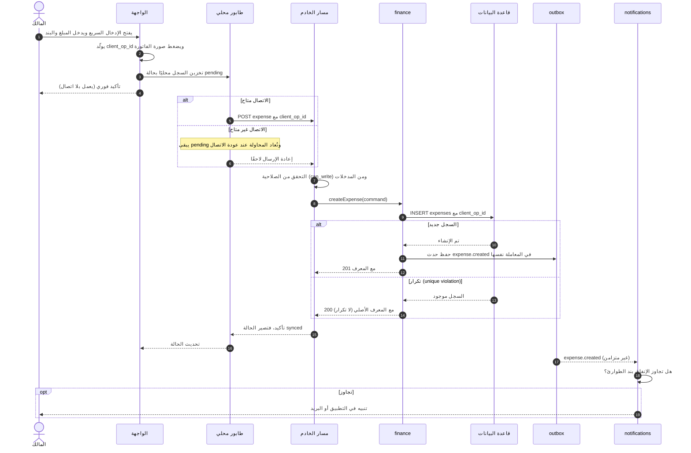

**ملاحظات على UC-07:**
- الصورة تُضغط في المتصفح قبل التخزين المحلي، لأن حجم الصورة الكامل قد يتجاوز الذاكرة المحلية.
- التكرار لا يُنشئ سجلًا ثانيًا، ويعيد المعرف الأصلي، فلا تتضاعف المصروفات بإعادة الإرسال.
- التنبيه بتجاوز الميزانية غير متزامن، فلا يبطئ التسجيل.
- إن رُفض الطلب بخطأ تحقق (مثل مبلغ صفر) يبقى السجل المحلي بحالة `rejected` ويظهر للمالك ليصححه، ولا يُحذف صامتًا.

---

## 9. مخطط التسلسل: UC-21 إنهاء مرحلة (وفق 3.23 والوحدات المعزولة)

القاعدة هنا: `projects` (L1) لا تستدعي `quality` ولا `materials` (L2) مباشرة. تبدأ الأوامر بطلب إغلاق، وتعود النتائج بأحداث، فتقرر `projects` في النهاية.

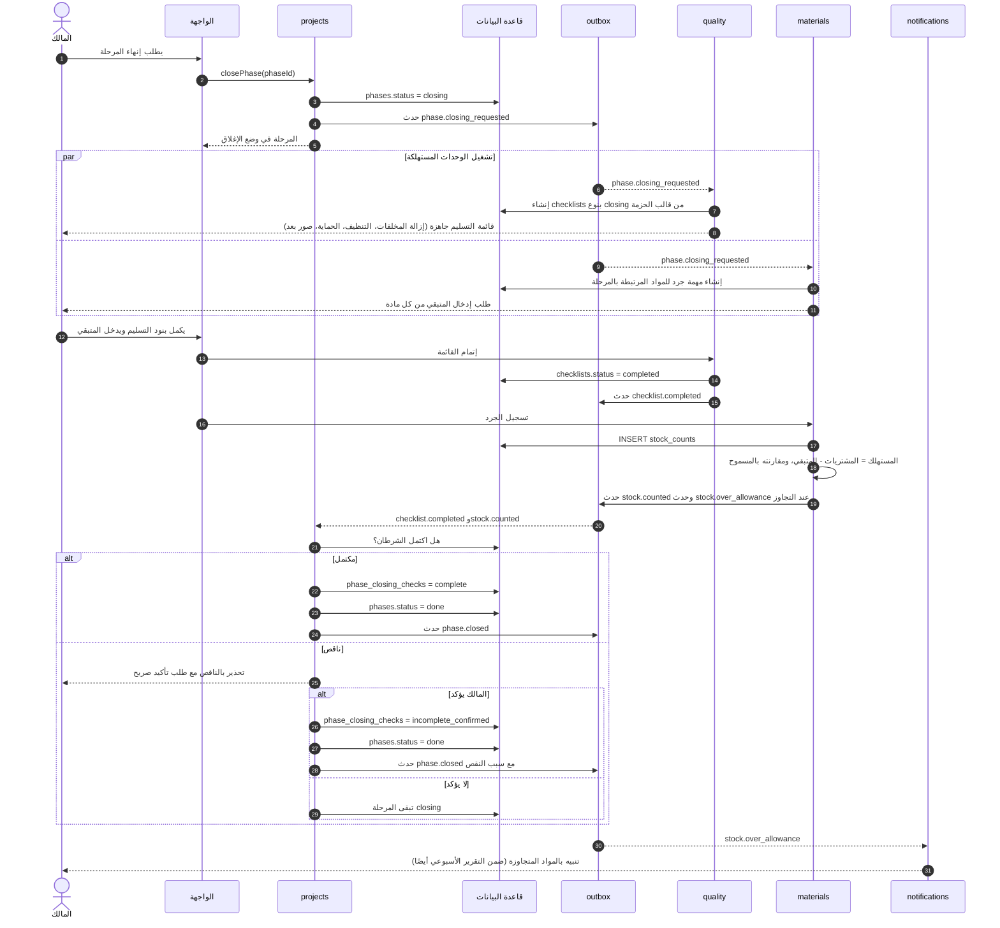

**ملاحظات على UC-21:**
- كل وحدة تنشئ ما يخصها عند استلام الحدث، فلا يعرف `projects` تفاصيل التنظيف أو الجرد، ويعرف فقط هل اكتمل الشرطان.
- التأخر في أي وحدة لا يوقف الأخرى. الحدث ينتظر في `outbox` حتى يعالجه المستهلك، وإعادة المعالجة لا تضر لأن المستهلك مصمم ليكون idempotent.
- القرار النهائي بيد المالك دائمًا، فلا يمنع النظام الإغلاق آليًا (القرار D2).
- إن غابت قائمة التسليم أو الجرد، لا تُحذف المرحلة من الجدول، بل تبقى `closing` وتظهر في التقرير الأسبوعي (3.21).

---

## 10. ما تم في هذه المرحلة وما تبقى

- **تم:** حالات الاستخدام، ومخططات الأنشطة، وERD الإصدار 2 (مطبّق في `schema.sql`)، ومخططات التسلسل لـUC-07 وUC-21.
- **يتبقى:** مراجعة المخططات مع المراجع الهندسي فيما يخص قوائم التسليم، والقرارات الخمس لمراجعة المخططات (لم تُحسم)، ومخططات الواجهات والمتطلبات المرقّمة. أما التقنية فقد حُسمت (A8 وA9 وA11).

---

## 11. مخطط التسلسل: UC-01 التسجيل برقم الهاتف وكلمة المرور (ترحيل 0003، 12 نوفمبر 2026)

القاعدة هنا: لا يوجد مستخدم بلا ملف شخصي. Supabase Auth يضيف المستخدم إلى `auth.users`، وفي المعاملة نفسها يُنشئ الـtrigger `on_auth_user_created` سجله في `profiles`. لذلك لا يحتاج التطبيق إلى جلسة مفتوحة لإنشاء الملف، وهذا مهم لأن التسجيل مع تأكيد الرقم لا يعيد جلسة.

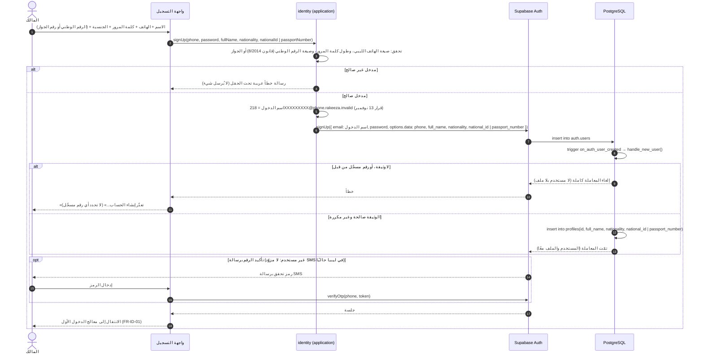

**ملاحظات على UC-01:**
- الدالة `handle_new_user` تعمل بصلاحية مالكها (`security definer`) لأن المستخدم الجديد لا يملك بعد حق الكتابة في `profiles`، و`search_path` فارغ وكل الأسماء مؤهلة بالمخطط، فلا يمكن خداعها بكائن بالاسم نفسه.
- الاسم يأتي من بيانات التسجيل، ويُحذف ما حوله من مسافات، والاسم الفارغ يُخزَّن `null`.
- **وثيقة الهوية (FR-ID-06، ترحيل 0005):** الليبي يُدخل الرقم الوطني، وغير الليبي رقم الجواز، ويُحفظ الرقم المطابق للجنسية فقط. لا يمكن تجاوز النموذج باستدعاء Supabase مباشرة، لأن الـtrigger نفسه يرفض التسجيل بلا وثيقة. والرقم مكتوب مرة واحدة: يستطيع المستخدم تعديل اسمه فقط (صلاحيات أعمدة). ولا يراه أحد غير صاحبه، لا أعضاء المشروع ولا التقارير.
- رسالة رفض الرقم المكرر لا تذكر أي رقم مسجّل، حتى لا يُستخدم النموذج للتحقق من أرقام الآخرين.
- حذف المستخدم من `auth.users` يحذف ملفه تلقائيًا (`on delete cascade`).
- `profiles` خاص بصاحبه: لا يقرأ المستخدم ولا يعدّل إلا ملفه (سياسة `own_profile`)، وهذا مختبَر في `tests/db/rls_0003.test.sql`.
- لا كيان جديد في ERD: الترحيل يضيف دالة وtrigger فقط.

---

## 12. مخطط التسلسل: UC-02 معالج المشروع الأول (ترحيل 0006، 14 نوفمبر 2026)

القاعدة هنا: الإجابات تبقى في المتصفح بين الخطوات، والمشروع لا يُنشأ إلا مرة واحدة في الخطوة الأخيرة، في معاملة واحدة، وبصلاحية المالك نفسه (RLS).

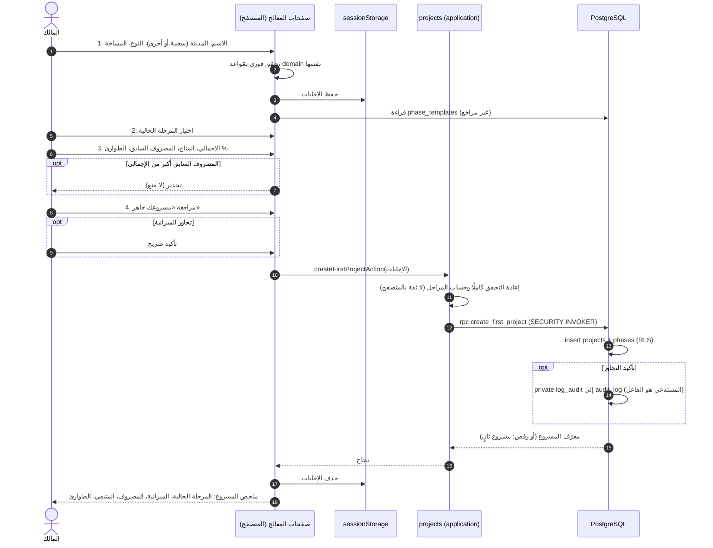

**ملاحظات على UC-02:**
- المعالج أربع خطوات؛ خطوة «فريق المشروع» في التصميم (S02.4) مؤجلة لأنها تدعو حسابات مهندس ومقاول المستبعدة.
- كل الحسابات (المتبقي، الطوارئ) في domain بأرقام عشرية؛ الدالة في القاعدة تحفظ فقط، وقيود الجداول تتحقق مرة ثانية.
- فشل أي إدخال (مثل حالة مرحلة غير صالحة) يلغي المعاملة كلها، فلا يبقى مشروع بلا مراحل.

---

## 13. النواة كما بُنيت: المخططات والحدود المعروفة (الدرجة 3، 19 نوفمبر 2026)

**الغرض:** القسم 17.2 من المرجع يعرّف الدرجة 3 بأنها «مكتوبة في التقرير مع مخطط وحدود معروفة». هذا القسم يفعل ذلك لميزات
النواة (الأولوية 0) **كما بُنيت فعلًا**، لا كما صُمّمت في أكتوبر. حيث يختلف المبني عن التصميم الأول (مثل العمل بلا اتصال) يُقال ذلك صراحة.
كل قاعدة مذكورة هنا لها اختبار؛ أسماء الملفات بين قوسين.

### 13.0 خريطة القسم

| الميزة | المخطط | الاختبارات الرئيسية | الحدود |
|---|---|---|---|
| 3.11 الحسابات والصلاحيات | 11 (التسجيل)، 13.1 (الصلاحيات) | `tests/db/rls*.test.sql`، `journey.spec.ts` (الغريب) | 13.9 |
| 3.1 المشاريع والمراحل والمهام | 12 (المعالج)، 13.5 | `phase-schedule.test.ts`، `tasks.test.ts`، `rls_0010`، `rls_0012`، `journey.spec.ts` | 13.9 |
| 3.2 الميزانية والمصروفات | 13.2، 13.3، 13.4 | `expense*.test.ts`، `change-expense.test.ts`، `rls_0009`، `rls_0015`، `rls_0016`، `expense-edit.spec.ts`، `expense-filter.spec.ts` | 13.9 |
| 3.19 الإدخال السريع | 13.2 | `create-expense.test.ts`، `quick-expense-timing.spec.ts`، `receipt.spec.ts` | 13.9 |
| 3.4 الوثائق والصور | 13.6 | `photo.test.ts`، `document.test.ts`، `rls_0013`، `rls_0014`، `photos.spec.ts`، `documents.spec.ts` | 13.9 |
| 3.5 لوحة التحكم | 13.7 | `next-step.test.ts`، `tasks.test.ts` (`overallProgress`)، `journey.spec.ts` | 13.9 |

### 13.1 نموذج الصلاحيات (3.11، NFR-SEC-01)

القاعدة هنا: **قاعدة البيانات هي التي تقرر**، لا الواجهة. كل جدول فيه `project_id` وعليه RLS. الخادم يستعمل جلسة المستخدم نفسه
دائمًا، ولا يستعمل مفتاح الخدمة (service role) أبدًا، فلا يستطيع خطأ في الكود أن يتجاوز RLS.

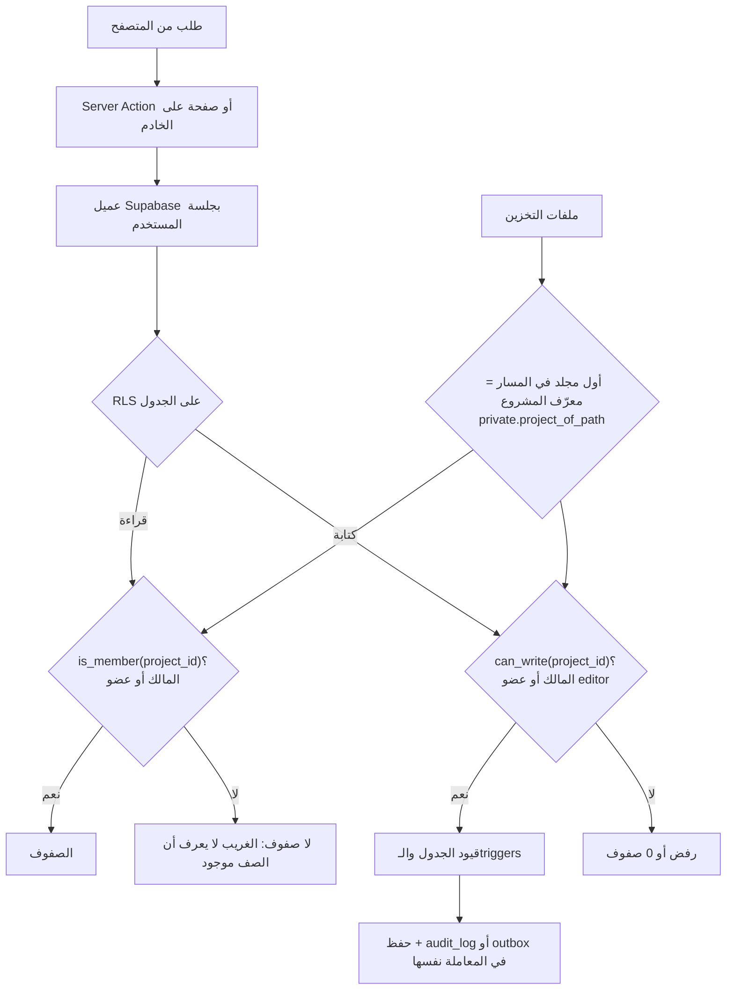

- الملفات تتبع القاعدة نفسها: أول مجلد في مسار كل ملف هو معرّف المشروع، وسياسات `storage.objects` تسأل `is_member` للقراءة
  و`can_write` للرفع والحذف (ترحيل 0013).
- الدوال العامة الجديدة تُسحب منها صلاحية `anon` صراحة، لأن Supabase يمنحها افتراضيًا (درس ترحيل 0011).
- كل جدول جديد له اختبار يثبت أن الغريب لا يقرأ ولا يكتب، وكل ترحيل جديد جُرّب باختبار الطفرة: يُكسر عمدًا فيفشل الاختبار.

### 13.2 تسجيل مصروف سريع كما بُني (UC-07، FR-FIN-02، NFR-USE-03)

**الفرق عن التصميم الأول (القسمان 4.1 و8):** لا طابور محلي ولا عمل بلا اتصال، لأن 3.20 خلف علم ميزة ولم تُبنَ. لكن منع التكرار
مبني من الآن (`client_op_id`)، فيصير الطابور المحلي إضافة لا إعادة تصميم.

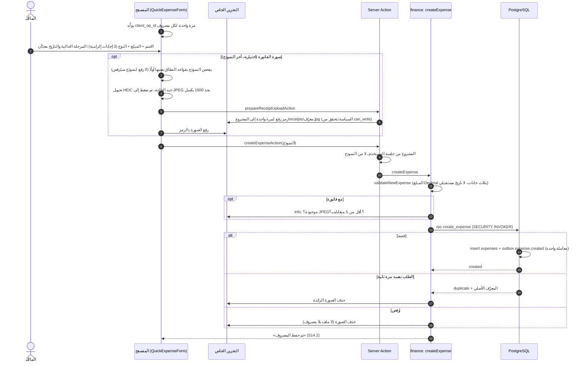

### 13.3 تعديل المصروف وحذفه مع سجل التدقيق (FR-SYS-03، ترحيل 0016)

القاعدة هنا: **سجل التدقيق تكتبه قاعدة البيانات نفسها بـtrigger**، فلا يوجد طريق للتعديل أو الحذف (الواجهة، أو استدعاء مباشر للـAPI)
يتجاوزه. سياسة الكتابة على `expenses` موجودة منذ 0001، و0016 لم يضف طريقًا جديدًا بل أمّن الموجود.

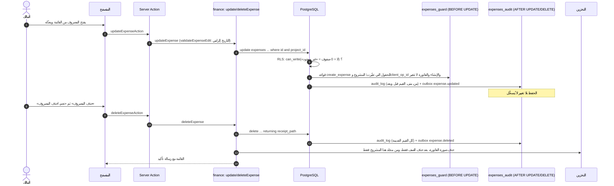

### 13.4 قائمة المصروفات وتصفيتها (S13.1، S13.2، أساس FR-FIN-05)

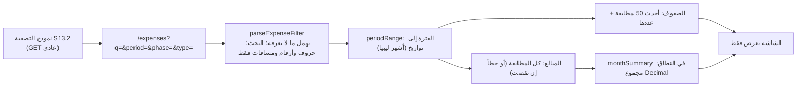

- مجموع «مجموع النتائج» يأتي من **كل** المصروفات المطابقة لا من الخمسين الظاهرة، وهذا معيار FR-FIN-05 (المجموع يطابق المصروفات).
- إن أعاد Supabase مبالغ أقل من العدد (حده 1,000 صف في الطلب)، يرمي القارئ خطأً بدل عرض مجموع خاطئ بصمت.

### 13.5 المراحل والتأخير والمهام (FR-PRJ-03، FR-PRJ-04)

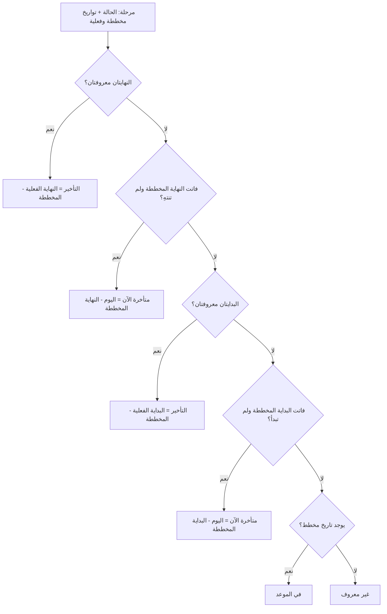

- النهاية تُفحص قبل البداية، لأن التأخر في الإنهاء هو ما يدفع المالك ثمنه (`phaseDelay`).
- «اليوم» هو تاريخ ليبيا (`todayInTripoli`)، والتواريخ الفعلية لا تكون بعد اليوم، والنهاية لا تسبق البداية (النطاق، ثم قيود 0010).
- الحالة والتواريخ قد تختلفان (مثل «قيد التنفيذ» بلا بداية فعلية)، وهذا مسموح عمدًا (القرار D2): المالك يسجّل ما يعرفه.
- **المهام:** نسبة إنجاز المرحلة = المنجزة ÷ الكل، مقرّبة للأسفل. المهمة متأخرة إذا فات موعدها ولم تُنجز. الـtrigger
  `tasks_guard` (0012) يمنع ربط مهمة بمرحلة مشروع آخر أو نقلها إلى مشروع آخر، ويضبط وقت الإنجاز بنفسه.

### 13.6 رفع الملفات: صور الموقع والوثائق وصورة الفاتورة (FR-DOC-01، FR-DOC-02، NFR-SEC-03)

القاعدة هنا: **الملف لا يمر بخادم التطبيق**. المتصفح يرفعه مباشرة إلى التخزين الخاص برمز لمرة واحدة، ثم يتحقق الخادم منه
قبل تسجيله. ثلاث خطوات، والنموذج يُفحص في المتصفح قبل الرفع.

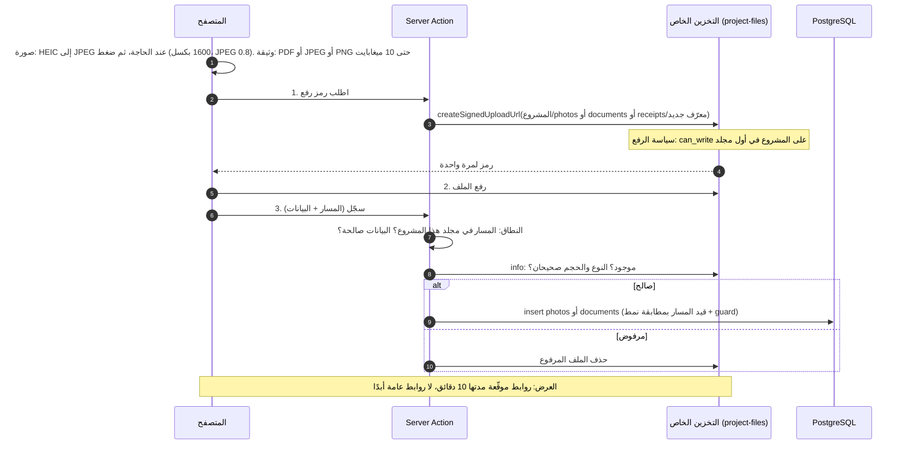

### 13.7 لوحة المشروع S07.1 (FR-DSH-01، FR-DSH-02)

كل رقم في اللوحة يأتي من نطاق وحدته (القاعدة R5)؛ اللوحة تعرض فقط.

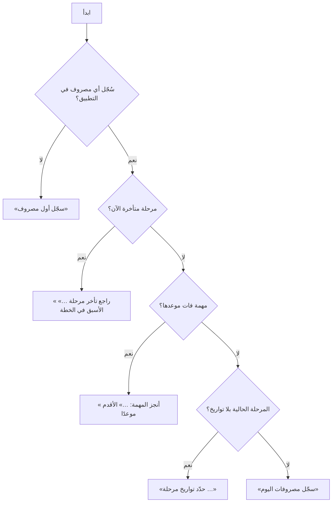

- **التقدم العام** (قرار 19 نوفمبر): متوسط المراحل بوزن متساوٍ؛ المكتملة 100%، والتي لها مهام نسبة مهامها المنجزة، وغيرها 0%،
  مقرّبًا للأسفل حتى لا يظهر 100% قبل اكتمال كل المراحل (`overallProgress`).
- **المصروف** = المصروف قبل التطبيق + مجموع المصروفات المسجلة (`totalSpent`)، و**المتبقي والطوارئ** من `budgetSummary`.

### 13.8 تحديث ERD (الإصدار 2.2، الترحيلات 0010–0016)

لا جداول جديدة بعد 0009؛ الترحيلات أضافت أعمدة وقيودًا وtriggers على جداول ERD الإصدار 2:

| الترحيل | الجدول | ما أُضيف | لماذا |
|---|---|---|---|
| 0010، 0011 | phases | `update_phase_schedule`، وقيود ترتيب التواريخ، وسحب `anon` | FR-PRJ-03 |
| 0012 | tasks | `created_at`، وقيد طول العنوان، وtrigger `tasks_guard` | FR-PRJ-04 |
| 0013 | photos، storage | عمودا الحجم ووقت الرفع، وtrigger، والمخزن `project-files` وسياساته، و`private.project_of_path` | FR-DOC-02، NFR-SEC-03 |
| 0014 | documents | أعمدة العنوان والمرحلة والإصدار والنوع والحجم (10 ميغابايت)، وقيد المسار بمطابقة نمط، وtrigger | FR-DOC-01 |
| 0015 | expenses | قيد مسار الفاتورة، وفهرس فريد، و`create_expense` بمعامل الفاتورة | UC-07 |
| 0016 | expenses | trigger `expenses_guard` وtrigger `expenses_audit`؛ الأحداث `expense.updated` و`expense.deleted` | FR-SYS-03 |

### 13.9 الحدود المعروفة لكل ميزة من النواة

هذه حدود يعرفها الفريق ويقولها للجنة؛ ليست أخطاء مخفية. ما يحتاج قرارًا مسجّل في تقرير الحالة (القسم 7).

**3.11 الحسابات والصلاحيات**
- الدخول برقم الهاتف دون رسالة SMS (لا مزوّد متاح في ليبيا)، فالرقم لا يُتحقق من ملكيته.
- لا شاشة لدعوة عضو إلى المشروع؛ الأعضاء (`editor`، `viewer`) يُضافون من قاعدة البيانات فقط. رابط المشاركة للمهندس (بدل حساباته) لم يُبنَ.
- لا استعادة لكلمة المرور (تحتاج قناة تحقق).

**3.1 المشاريع والمراحل والمهام**
- مشروع واحد لكل مالك في النسخة الأولى.
- لا مخطط Gantt (FR-PRJ-03 يستثنيه صراحة)، ولا ترابط بين المراحل: تأخر مرحلة لا يؤخر التي بعدها تلقائيًا.
- لا تُضاف مرحلة ولا يُعاد ترتيبها من الواجهة؛ قائمة المراحل مقترحة ولم يراجعها مهندس (`unreviewed`).
- لا يُعدَّل عنوان المهمة ولا موعدها بعد إنشائها؛ تُغيَّر حالتها أو تُحذف فقط.

**3.2 الميزانية والمصروفات، و3.19 الإدخال السريع**
- لا عمل بلا اتصال (3.20 خلف علم ميزة)؛ منع التكرار مبني فقط.
- لا عملة أجنبية (3.18، الأولوية 1)؛ كل المبالغ بالدينار.
- القائمة تعرض أحدث 50 مصروفًا؛ الأقدم يُصل إليه بالتصفية. والمجموع يرفض العمل بدل أن يخطئ إن تجاوز المطابق 1,000 صف.
- البحث لا يوحّد الهمزات والتاء المربوطة («اسمنت» لا يجد «إسمنت»)، ولا فترة بتاريخين يختارهما المالك.
- لا تقرير حسب المرحلة ولا مقارنة المخطط بالفعلي بعد (FR-FIN-05).
- صورة الفاتورة لا تتغير من شاشة التعديل.
- زمن الشخص في الإدخال السريع لم يُقس (قيس نصيب التطبيق فقط: نحو 0.8 ثانية).

**3.4 الوثائق والصور**
- تحويل HEIC يعمل في المتصفحات التي اختُبرت، لكنه لم يُجرَّب بصورة من آيفون حقيقي (الاختبار متخطى حتى تتوفر الصورة).
- إن أُغلقت الصفحة بين رفع الملف وتسجيله يبقى ملف بلا صف؛ ملف خاص وغير ضار، ولا تنظيف تلقائي له بعد.
- Supabase يمنع حذف الملفات بـSQL، فحذف حساب من القاعدة لا يحذف ملفاته؛ الاختبارات تحذف ملفاتها بنفسها عبر Storage API.
- مكتبة HEIC (`heic-to`) رخصتها LGPL، وتُحمَّل عند الحاجة فقط.

**3.5 لوحة التحكم**
- S07.3 (بلا اتصال) وS07.4 (تنبيهات الدفعات والعيوب والجاهزية) لم تُبنيا لأنهما تعتمدان على ميزات لم تُبنَ.
- «المواد والكميات» تظهر «قريبًا».
- **لا عامل يعالج أحداث الـoutbox بعد**: الأحداث تُكتب في المعاملة نفسها وتنتظر في الجدول، فلا تنبيه بتجاوز الميزانية خارج اللوحة.

**عام**
- الموقع المنشور يعمل على القاعدة التجريبية؛ لا قاعدة إنتاج بعد.
- اختبارات الرحلة الكاملة تُشغَّل يدويًا على القاعدة التجريبية، وليست في CI.
- شاشات بُنيت دون تصميم من الزميل (تعديل المصروف وحذفه، حقل الفاتورة، صف «المتبقي» في اللوحة، صفحة «المزيد»)، كلها مسجّلة في سجل التغييرات.

---

## 14. الأولوية 1، ميزة 3.7 (قيد البناء): الشريحة 1، الالتزامات والدخل والرصيد خلال 30 يومًا (19 نوفمبر 2026)

القاعدة هنا (FR-DEC-01): **الدخل الذي يصل بعد موعد التزام لا يغطيه.** لذلك لا يكفي مجموع الدخل ناقص مجموع الالتزامات؛ الرصيد
يُحسب يومًا بيوم.

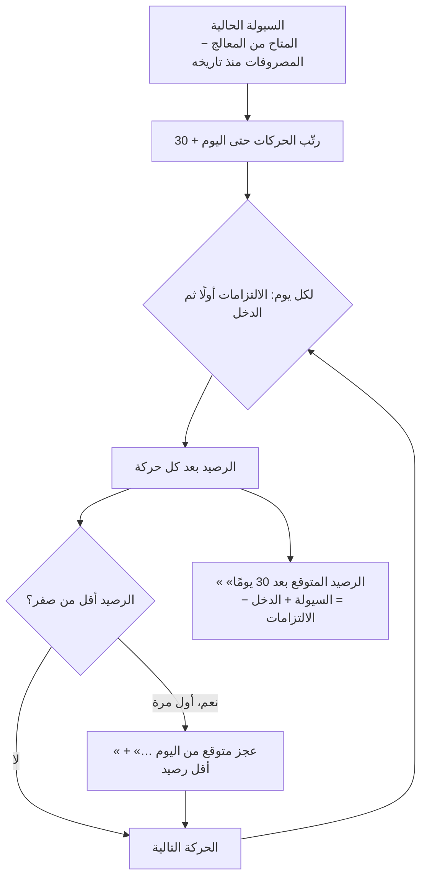

- الالتزام الذي فات موعده يُحسب مستحقًا اليوم، ويُعلَّم «فات موعده».
- **الحدود:** لا وسم «دُفع» (تُحذف الحركة ويُسجَّل الدفع مصروفًا)؛ و«السيولة الحالية» تفترض أن المصروف المؤرخ قبل تاريخ «المتاح»
  خارجه؛ ودون «المتاح» لا رصيد. الشريحة 2 في القسم 15، والشريحة 3 في القسم 16.

---

## 15. الأولوية 1، ميزة 3.7: الشريحة 2، سجل الأسعار وعروض الموردين S24 (19 نوفمبر 2026)

القاعدة هنا: **النظام يعرض ما سجله المالك فقط ولا يتوقع الأسعار** (3.10)، و**العرض المنتهي يُعلَّم دائمًا** فلا يدخل حسابًا بصمت (FR-DEC-03).

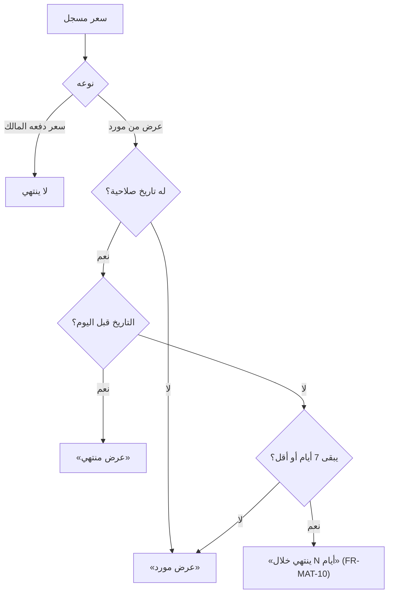

- **التجميع:** أسعار المادة الواحدة بالوحدة نفسها معًا، مهما اختلفت المسافات أو حالة الحروف اللاتينية؛ والوحدات المختلفة لا تُخلط
  (الطن والكيلو لا يُقارنان). S24.1 صف لكل مادة بآخر سعر، وS24.2 تاريخها من الأحدث.
- **قراءة المبالغ** صارت في `shared-kernel/money-input.ts` (`readMoneyInput`)، لأن المالية والمواد في المستوى نفسه (القاعدة R2)؛
  السعر يقبل الصفر، والمبالغ المدفوعة لا.
- **الحدود:** لا رسم بياني (FR-MAT-09، الأولوية 4)؛ لا تعديل للسعر بعد حفظه (يُحذف ويُسجَّل من جديد)؛ تكلفة النقل مبلغ للتوريد كله
  لا لكل وحدة، فتُعرض بجانب السعر ولا تُضاف إليه؛ تنبيه العروض في التقرير الأسبوعي لم يُبنَ.

---

## 16. الأولوية 1، ميزة 3.7: الشريحة 3، مقارنة الاستمرار والتوقف S18 (20 نوفمبر 2026)

القاعدة هنا (قرار المالك 20 نوفمبر): **لكل سيناريو تكلفة «الآن» وتكلفة «لاحقًا».** تكلفة الآن تُدفع اليوم وتمر بتوقعات السيولة
لثلاثين يومًا من المالية (قاعدة التوقيت نفسها في القسم 14)؛ وتكلفة لاحقًا هي ما يلزم لإكمال المشروع، وعليها وحدها تنطبق نسبة تغير
الأسعار (FR-DEC-02). والمواد الموجودة في الموقع مدفوعة، فتُخصم مرة واحدة قبل أي شيء (FR-DEC-01: بلا عد مزدوج).

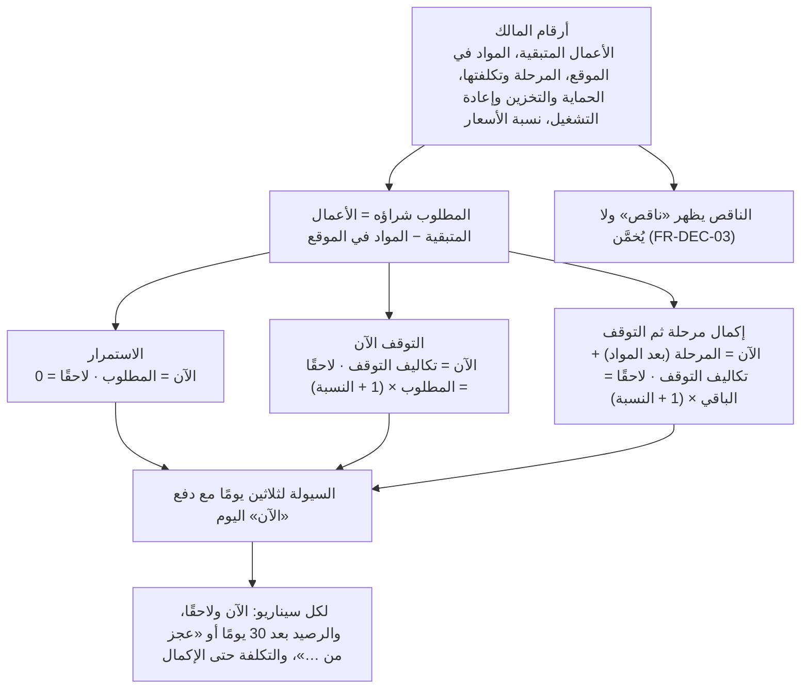

- **المثال المحسوب يدويًا في الاختبار الشامل:** سيولة 100,000، التزام 30,000 بعد 5 أيام، دخل 40,000 بعد 10؛ أعمال 150,000 ومواد 20,000،
  مرحلة 50,000، توقف 9,500، أسعار +10%: الاستمرار الآن 130,000 وعجز يصل إلى −60,000؛ التوقف الآن 9,500 ولاحقًا 143,000 ورصيد 100,500؛
  إكمال المرحلة الآن 39,500 ولاحقًا 110,000 ورصيد 70,500.
- **S18.2 قائمة للمالك:** أربع خطوات يعلّمها المالك، لكل منها من يقوم بها في الواقع، وملاحظة، والطريقة المختارة. النظام يسجّل ولا يعتمد.
- **فحص الأسعار (FR-DEC-03):** العروض المنتهية، والمواد التي آخر سعرها أقدم من 30 يومًا، تظهر فوق المقارنة مع رابط لسجل الأسعار.
- **الحدود:** التكاليف مبالغ يدخلها المالك (حتى يُبنى جدول الكميات 3.9)؛ مدة التوقف لا تدخل الحساب إلا من خلال مبالغ التخزين والحماية التي
  يقدّرها المالك؛ لا يُقترح أي رقم للحماية أو التخزين (محتوى هندسي)؛ ونقاط التوقف الآمنة (3.14، FR-DEC-04) لم تُبنَ.

---

## 17. الأولوية 1، ميزة 3.18: العملة وسعر الصرف المرجعي (20 نوفمبر 2026)

القاعدة هنا (FR-FIN-04): **كل المجاميع بالدينار**، والمصروف بعملة أخرى يحفظ مبلغه الأصلي وعملته وسعره، ومكافئه بالدينار هو الأصلي
× السعر مقرّبًا للدرهم. والسعر **سعر المالك** (ما دفعه أو ما يعتمده)، لا يُجلب ولا يُتوقع ولا يُقدَّم على أنه رسمي.

```mermaid
sequenceDiagram
  autonumber
  actor O as المالك
  participant L as سجل أسعار الصرف
  participant F as نموذج المصروف (المتصفح)
  participant D as finance: validateForeign
  participant DB as PostgreSQL

  O->>L: يسجّل سعره لكل عملة بتاريخه (اختياري)
  O->>F: يفتح «دُفع بعملة أخرى» ويختار العملة
  L-->>F: آخر سعر لهذه العملة (يبدأ به الحقل، ويمكن تغييره)
  O->>F: المبلغ بالعملة
  F->>D: الأصلي × السعر
  D-->>F: المكافئ بالدينار (يُعرض، لا يُكتب)
  F->>DB: create_expense(..., الأصلي، العملة، السعر) بعد إعادة الحساب على الخادم
  DB->>DB: قيد: amount_lyd = round(الأصلي × السعر، 3)، وأربع عملات، والسعر مع العملة
```

- **السعر لكل مصروف:** يُحفظ مع المصروف، فإضافة سعر أحدث إلى السجل لا تغيّر مصروفًا سُجّل من قبل؛ وتعديل سعر المصروف نفسه يعيد حساب مكافئه.
- **الحدود:** أربع عملات فقط (الدولار، اليورو، الليرة التركية، اليوان)؛ العملة في المصروفات فقط، لا في الالتزامات ولا في سجل أسعار المواد؛
  ولا تحويل للميزانية أو تقرير بعملة أخرى.

---

## 18. الأولوية 1، ميزة 3.16 (الجزء المالي): الشريحة 1، توزيع الميزانية على المراحل وتنبيه الانحراف (20 نوفمبر 2026)

القاعدة هنا (FR-FIN-11، القرار D5): **تنبيه، لا منع** (القرار D2). مخصص لكل مرحلة يدخله المالك (S15.2)، فإذا زاد مصروف المرحلة على
مخصصها × 1.10 ظهر «تجاوز المخصص بأكثر من 10%» في S15.2، وعدد هذه المراحل في S15.1.

```mermaid
flowchart TD
  A["مخصص كل مرحلة (budget_categories، ترحيل 0021)"] --> P[budgetPlan في نطاق المالية]
  E["المصروفات مجموعة حسب المرحلة (sumByPhase)"] --> P
  T["الميزانية − بند الطوارئ = المتاح للمراحل"] --> P
  P --> R{"المصروف > المخصص × (1 + 10%)؟"}
  R -- نعم --> W["«تجاوز المخصص بأكثر من 10%» (S15.2) وعددها (S15.1)"]
  R -- لا --> N[النسبة المستخدمة فقط]
  P --> O{"مجموع المخصصات > المتاح للمراحل؟"}
  O -- نعم --> OW[تنبيه، ويُحفظ التوزيع كما هو]
```

- **حين يُحسب التنبيه** (قرار المالك): عند فتح شاشات الميزانية، فلا يبطئ تسجيل المصروف (شرط FR-FIN-11). الإشعار بالبريد أو داخل التطبيق
  ينتظر عامل الأحداث (3.21).
- **صفّان إضافيان على تصميم S15.2** حتى تطابق المجاميع: «مصروفات بلا مرحلة»، و«المصروف قبل التطبيق» (لا تدّعيه أي مرحلة).
- **الحدود:** مخصص بالمراحل فقط (لا بنود داخل المرحلة)؛ العقود (S17) «قريبًا». استهلاك بند الطوارئ بالأعمال الإضافية في القسم 19.

---

## 19. الأولوية 1، ميزة 3.16 (الجزء المالي): الشريحة 2، الأعمال الإضافية والتغييرات (20 نوفمبر 2026)

القاعدة هنا (FR-FIN-10، وقرار المالك 20 نوفمبر): **المعتمد يُخصم من الطوارئ أولًا**، وما زاد عليها يرفع التكلفة المتوقعة فوق الميزانية؛
**المرفوض لا يؤثر**، و**المقترح يُعرض منفصلًا ولا يُحسب**. ولا عقد الآن (العقود أولوية 2)؛ يمكن ربط العمل بعقد لاحقًا.

```mermaid
stateDiagram-v2
  [*] --> مقترحة: إضافة
  [*] --> معتمدة: إضافة معتمدة مباشرة
  مقترحة --> معتمدة: «اعتماد» بعد تأكيد
  مقترحة --> مرفوضة: «رفض» بعد تأكيد
  معتمدة --> [*]: حذف (يبقى في سجل التدقيق)
  مرفوضة --> [*]: حذف
  مقترحة --> [*]: حذف
```

- **الأثر (contingencyUse):** متبقي الطوارئ = الطوارئ − المعتمد (لا يقل عن صفر)؛ وما زاد = المعتمد − الطوارئ؛ والتكلفة المتوقعة = الميزانية + ما زاد.
  إذا بلغ المعتمد الطوارئ أو زاد ظهر «استُهلك بند الطوارئ» في S15.1 (الجزء الثاني من FR-FIN-11)، وصف «احتياطي المشروع» في S15.2 يذكر المستخدم والمتبقي.
- **كل تغيير مسجّل:** الاعتماد والرفض تعديلان يكتبهما trigger التدقيق بالقيم قبل وبعد (0022).
- **الحدود:** لا عقود ولا دفعات (الأولوية 2)؛ لا تصميم لهذه الشاشات؛ المعتمد لا يُسجَّل مصروفًا تلقائيًا (يُسجَّل الدفع مصروفًا حين يحدث، فلا عدّ مزدوج).

---

## 20. الأولوية 1، ميزة 3.3: الشريحة 1، حاسبات الكميات (20 نوفمبر 2026)

القاعدة هنا (master 3.3، FR-MAT-04، FR-MAT-05، وقرار المالك 20 نوفمبر): **معادلات برمجية محددة**، لا ذكاء اصطناعي، ولا رقم هندسي
مكتوب في الكود. معامل وزن الحديد **بيانات** في `calc_coefficients` (ترحيل 0023) بحالة `unreviewed` حتى يعتمده مهندس باسمه وتاريخه.
والحاسبات **لا تحفظ شيئًا**: النموذج يُرسل بـGET فتبقى المدخلات في العنوان، و«تعديل المدخلات» يعيدها.

```mermaid
sequenceDiagram
  actor O as المالك
  participant P as صفحة /materials/rebar
  participant A as materials/application
  participant D as materials/domain
  participant DB as calc_coefficients (RLS: قراءة فقط)
  O->>P: القطر والطول والعدد (من جدول تفريد المهندس)، وهدر وسعر اختياريان
  P->>A: getRebarCalculator(المدخلات)
  A->>DB: المعامل وحالته
  DB-->>A: 162، unreviewed
  A->>D: calculateRebar
  alt مدخلات خاطئة
    D-->>P: أخطاء الحقول (تبقى المدخلات)
  else لا معامل في القاعدة
    D-->>P: تنبيه بدل رقم
  else
    D-->>P: وزن السيخ، والأطوال، والوزن (مع الهدر)، والطن، والتكلفة
    P-->>O: S22.2 مع «المعامل غير مراجَع من مهندس بعد»
  end
```

- **الحديد (FR-MAT-04):** الوزن لكل متر = القطر² ÷ المعامل. الحساب دقيق (Decimal) والعرض مقرّب: وزن السيخ لخانتين، والإجمالي لأقرب كيلوغرام
  («قيمة تقريبية» كما في التصميم)، والطن والتكلفة من الوزن الدقيق. الهدر وسعر الطن **يدخلهما المالك**؛ النظام لا يقترح نسبة هدر.
- **الهندسية (FR-MAT-05):** حجم الخرسانة (ط × ع × س)، ومساحة التشطيب (ط × ع)، وعدد البلاط (المساحة ÷ مساحة البلاطة، مقرّبًا لأعلى). هندسة فقط
  «دون إضافات».
- **الحدود:** قطر واحد في كل حساب (جدول التفريد متعدد الأقطار تعميق لاحق)؛ لا حفظ؛ الطوب والأسمنت والرمل والدهان تنتظر نسب المهندس؛
  جدول الكميات وتسجيل الشراء (S20.1 «بنود المواد»، S21) في الشريحة 2 (القسم 21).

---

## 21. الأولوية 1، ميزة 3.3: الشريحة 2، جدول الكميات والشراء (20 نوفمبر 2026)

القاعدة هنا (FR-MAT-01..03، FR-FIN-03، وقرار المالك 20 نوفمبر): **الشراء مصروف واحد**. المواد لا تعرف جدول المصروفات، والمالية لا تعرف
جدول المشتريات (المعمارية §4.3): المواد تكتب الشراء وحدث `purchase.recorded` في معاملة واحدة، و**طبقة التطبيق تسلّم الحدث للمالية فورًا**
لأن عامل الأحداث (3.21) لم يُبنَ ويحتاج مفتاح الخدمة. معالج المالية يجعل `client_op_id` للمصروف هو رقم الشراء، فتكرار المعالجة لا يضاعفه.

```mermaid
sequenceDiagram
  actor O as المالك
  participant A as إجراء التطبيق (src/app)
  participant M as materials
  participant DB as قاعدة البيانات
  participant F as finance
  O->>A: الكمية والسعر والمورد والتاريخ (S21.1)
  A->>M: recordPurchase
  M->>M: التحقق، وهل يتجاوز المسموح؟
  alt يتجاوز ولم يؤكد المالك
    M-->>O: تنبيه بالأرقام وخانة تأكيد (لا شيء يُحفظ)
  else
    M->>DB: record_purchase: الشراء + purchase.recorded (معاملة واحدة) + تسجيل التأكيد إن وُجد
    DB-->>M: رقم الشراء
    A->>F: handlePurchaseRecorded(الحدث)
    F->>DB: create_expense بمفتاح = رقم الشراء
    alt نجح
      A->>M: linkExpense (المرجع يُكتب مرة واحدة)
      A-->>O: «حُفظ الشراء وسُجّل مصروفه»
    else فشل
      A-->>O: «حُفظ الشراء، وتعذّر تسجيل مصروفه» + زر «تسجيل المصروف» (آمن للتكرار)
    end
  end
```

- **البند (FR-MAT-01):** المادة والوحدة والكمية والمرحلة والمصدر واسم المراجع ونسبة الهدر. النسبة **من المهندس**؛ فارغة = صفر، والنظام لا يقترح نسبة
  (القرار D10 مفتوح). لا تكرار لـ(مادة، وحدة، مرحلة) حتى بلا مرحلة. البند الذي عليه مشتريات لا يُحذف.
- **التقدم (FR-MAT-02، 03):** المسموح = المخطط × (1 + الهدر)، والمتبقي للشراء = المخطط − المشترى (لا يقل عن صفر)، والتجاوز = المشترى − المسموح.
- **الحدود:** لا تعديل للبند ولا حذف للشراء بعد؛ لا جرد ولا «المتبقي بالموقع» (3.23)؛ لا رسم لتكلفة المواد؛ الحدث لا يُعلَّم «معالَجًا»
  لأن صندوق الأحداث مغلق دون مفتاح الخدمة، وعند بناء العامل يتخطى كل شراء له مرجع مصروف.

---

## 22. الأولوية 2، ميزة 3.12: الشريحة 1، نقاط التفتيش قبل الصب (20 نوفمبر 2026)

القاعدة هنا (FR-QLT-01، FR-QLT-02، FR-SYS-05، وقرار المالك 20 نوفمبر): **النظام يوثّق ولا يعتمد**. بنود القائمة محتوى هندسي، فهي **بيانات**
في `checklist_templates` بحالة `unreviewed` حتى يعتمدها مهندس (القرار D4 مفتوح). البند السليم يُسمّى «سليم» لا «معتمد»، وكل شاشة تقول
«يوثّق النظام الفحص ولا يحل محل المهندس المسؤول». والمشكلة لا تمنع اكتمال القائمة: تُسجَّل وتُعرض (القرار D2).

```mermaid
stateDiagram-v2
  [*] --> مفتوحة: create_checklist (نسخة من القالب، بحالة مراجعته)
  مفتوحة --> مفتوحة: نتيجة بند (سليم، توجد ملاحظة، لا ينطبق)
  مفتوحة --> مكتملة: آخر بند بلا نتيجة يُفحص\nحدث checklist.completed
  مكتملة --> مكتملة: تعديل نتيجة أو ملاحظة (يُسجَّل في التدقيق)
```

- **من أين تأتي القائمة:** `create_checklist` تنسخ بنود القالب في معاملة واحدة. القائمة أو البند المضاف بغيرها يُرفض (علم داخل المعاملة)، فكل قائمة نسخة
  حقيقية من قالب، وتحفظ حالة مراجعته وقت النسخ.
- **من يغيّر الحالة:** لا يكتب العميل حالة القائمة؛ trigger البنود يكملها حين يأخذ آخر بند نتيجة، ويصدر `checklist.completed` في المعاملة نفسها.
  ومن فحص ومتى يكتبهما الخادم. والنتيجة لا تُمحى بعد تسجيلها.
- **لا دوال `SECURITY DEFINER` في `public`** (قاعدة 0004 و0006): كل شيء بصلاحيات المستخدم تحت RLS، والحماية بالـtriggers.
- **الحدود:** صورة البند وقاعدة «الصورة الإلزامية» في الشريحة 2 (القسم 23)؛ لا حذف للقائمة (مغلق للمستخدمين)؛ «تسجيل عيب مرتبط» ينتظر سجل العيوب (3.17)؛
  قالب واحد (قبل الصب)، وقبل التغطية تُضاف قوالبه حين يكتبها المهندس.

---

## 23. الأولوية 2، ميزة 3.12: الشريحة 2، صورة بند الفحص (20 نوفمبر 2026)

القاعدة هنا (FR-QLT-01): «بند إلزامي الصورة لا يُعلَّم سليمًا دون صورة». **أي البنود تشترط صورة بيانات في القالب، لا كود.** واشتراطها لبند «فحص التسليح»
**قرار المالك** في 20 نوفمبر (عُرض عليه أن ينتظر المهندس، فاختار التحديد الآن)؛ ولذلك يبقى القالب `unreviewed` ويذكر مصدره أن الاشتراط قرار المالك لا اعتماد هندسي.
والقاعدة تمسّ «سليم» وحده: «توجد ملاحظة» و«لا ينطبق» تُسجَّل دون صورة (القرار D2: النظام لا يمنع تسجيل مشكلة).

```mermaid
sequenceDiagram
  actor O as المالك
  participant P as صفحة البند (المتصفح)
  participant S as الخادم (recordCheck)
  participant B as التخزين الخاص
  participant DB as قاعدة البيانات
  O->>P: النتيجة وصورة (تُضغط عند الاختيار)
  P->>P: «سليم» لبند يشترط صورة ولا صورة؟ رفض هنا، وتبقى الإجابات
  P->>S: طلب رمز رفع لمرة واحدة
  S-->>P: مسار جديد في مجلد checklists للمشروع + رمز
  P->>B: رفع الصورة بالرمز
  P->>S: الفحص + مسار الصورة
  S->>B: هل وصل الملف؟ JPEG وضمن الحجم؟
  S->>DB: تحديث البند (الحارس يتحقق من المجلد ومن القاعدة نفسها)
  alt نجح
    S->>B: حذف الصورة القديمة إن استُبدلت
  else فشل
    S->>B: حذف الصورة الجديدة (لا ملف بلا بند)
  end
```

- **صورة واحدة لكل بند** قابلة للاستبدال؛ الملف القديم يُحذف ويبقى مساره في سجل التدقيق. وتعرضها الصفحة برابط موقّع قصير العمر (NFR-SEC-03).
- **ثلاث طبقات للقاعدة:** الصفحة (قبل الرفع، فلا يُرفع شيء لفحص سيُرفض)، والخادم، وحارس قاعدة البيانات. والمسار يجب أن يكون في مجلد `checklists`
  لهذا المشروع، ولبند واحد فقط.
- **خلل وُجد وأُصلح:** React يمسح حقول النموذج بعد انتهاء دالة الإجراء، فرفضٌ في الصفحة كان يمسح النتيجة المختارة. صار التحقق والرفع في معالج
  الإرسال قبل الإجراء، واختبار الرحلة يتأكد أن الإجابة تبقى.

---

## 24. الأولوية 2، ميزة 3.15: بوابة الجاهزية قبل البدء (20 نوفمبر 2026)

القاعدة هنا (FR-PRJ-05، FR-PRJ-02، القرار D2، وقرار المالك 20 نوفمبر): **قائمة جاهزية واحدة للمشروع** (فحص التربة، المخططات المعتمدة، الترخيص، المهندس المشرف، عقد المقاول،
وفي مشروع إضافة طابق: التقييم الإنشائي للمبنى القائم)، من قالب `unreviewed` بالمحرك نفسه لقوائم الفحص (3.12)، وإجاباتها «متوفر / ناقص / لا ينطبق».
و**البوابة تنبّه ولا تمنع**: بدء مرحلة مع نقص يعرض الناقص ويطلب تأكيدًا صريحًا يُسجَّل.

```mermaid
sequenceDiagram
  actor O as المالك
  participant A as إجراء التطبيق (src/app)
  participant P as projects (L1)
  participant Q as quality (L2)
  participant DB as قاعدة البيانات
  O->>A: حالة المرحلة «قيد التنفيذ» (كانت «لم تبدأ»)
  A->>P: isPhaseStart؟
  A->>Q: getReadinessGapsAr (الناقص ولم يُراجَع)
  alt نقص ولم يؤكد
    A-->>O: قائمة الناقص + «أؤكد بدء المرحلة رغم النقص» (لا شيء يُحفظ)
  else نقص وأكّد
    A->>P: savePhaseSchedule(..., الناقص)
    P->>DB: update_phase_schedule + سجل التدقيق start_confirmed_with_gaps (معاملة واحدة)
  else لا نقص
    A->>P: savePhaseSchedule(..., null)
  end
```

- **لماذا في طبقة التطبيق:** `projects` (L1) لا يستورد `quality` (L2). فالتطبيق يحسب الناقص من `quality` ويمرّر لـ`projects` نص ما أُكّد، و`projects` لا يعرف ما الجاهزية.
- **قائمة واحدة للمشروع:** `create_readiness_checklist` تُنشئها أو تعيدها، وفهرس فريد يمنع الثانية؛ وقائمة الجاهزية بلا مرحلة، وقائمة ما قبل الصب لها مرحلة دائمًا.
- **التقييم الإنشائي** يُنسخ لمشروع إضافة طابق فقط (`only_for` في القالب)، ويبقى تنبيه FR-PRJ-02 في اللوحة كما هو.
- **الحدود:** تصميم S11.1 قائمة لكل مرحلة (استلام المرحلة السابقة، توفر المواد والتمويل) لم يُبنَ: بنوده ليست في المتطلبات. ولا «إرسال للمراجعة» ولا «اعتماد المهندس»:
  لا حسابات للمهندس (رابط مشاركة للقراءة بدلها، 3.11).

---

## 25. الأولوية 2، ميزة 3.14: نقاط التوقف الآمنة (20 نوفمبر 2026)

القاعدة هنا (FR-DEC-04، المرجع 3.14، تصميم S19.1، وقرار المالك 20 نوفمبر): **التطبيق لا يقرر سلامة التوقف**؛ يحدد المهندس نقطة التوقف (نص التصميم ظاهر على الشاشة).
لكل مرحلة **خطة توقف** واحدة بمحرك القوائم نفسه، من قالب `unreviewed`: بنود التصميم S19.1 وإجراءات الحماية الأربعة في المرجع (الحديد المكشوف، عزل الأسطح، التدعيم المؤقت،
تصريف المياه). وإجراءات الحماية **تأخذ تقدير المالك** لتكلفتها، ومجموعها يملأ «الحماية» في سيناريو التوقف (3.7).

```mermaid
flowchart LR
  T[قالب خطة التوقف<br/>غير مراجَع] -->|create_stop_plan| P[خطة توقف المرحلة<br/>واحدة لكل مرحلة]
  P --> M[إجراءات الحماية<br/>takes_cost]
  M -->|تقدير المالك cost_lyd| S[planProtectionCost<br/>المجموع دون «لا ينطبق»]
  S -->|المرحلة الحالية| F[«الحماية» في نموذج السيناريوهات<br/>تُملأ إن لم تُحفظ قيمة، وتبقى قابلة للتعديل]
```

- **إجابات البنود:** «جاهز / يحتاج عمل / لا ينطبق». والتكلفة صفر أو أكثر، على إجراءات الحماية وحدها (الحارس يرفضها على غيرها)، وتغييرها يُسجَّل في التدقيق.
- **المجموع** يحسبه نطاق `quality` (القاعدة R5)، ويركّب التطبيق الصلة: صفحة أرقام السيناريوهات تقرأ خطة المرحلة الحالية من `quality` وتمرّرها لنموذج `decisions`.
  لا رقم يُقترح: بلا تقدير لا يُملأ شيء (لا صفر لم يقدّره أحد).
- **الحدود:** «طلب مراجعة المهندس» في التصميم يحتاج حسابات المهندس (خارج النطاق)؛ التخزين وإعادة التشغيل ما زالا رقمين يكتبهما المالك في السيناريو؛ لا تسلسل للتوقف
  والاستئناف (يقرره المهندس).
