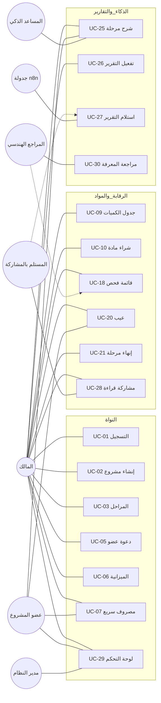
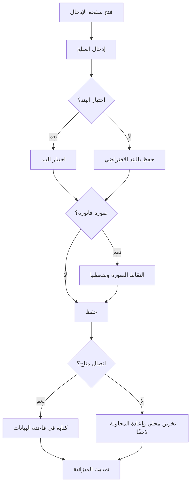
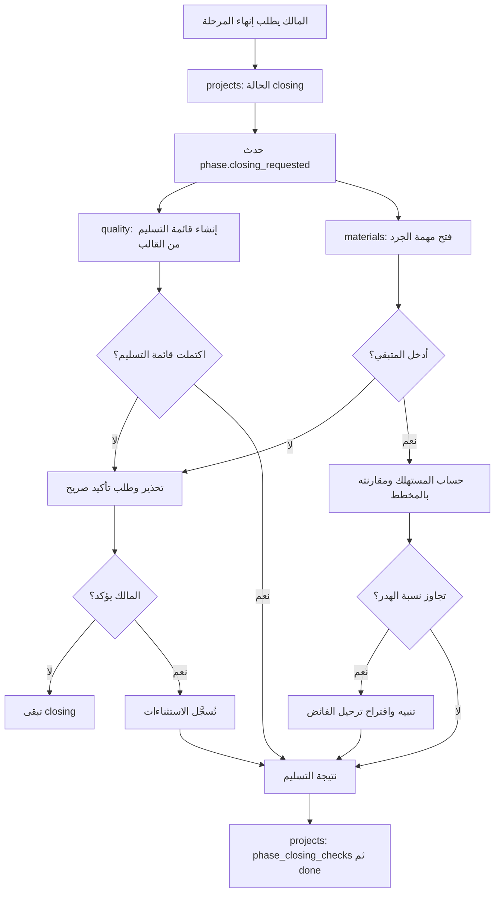
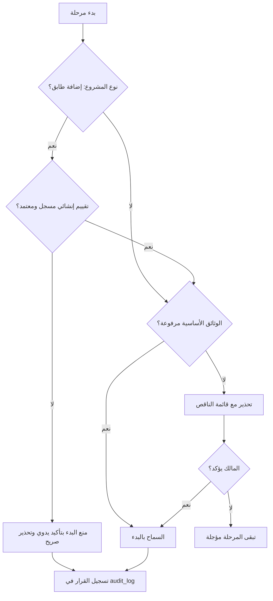
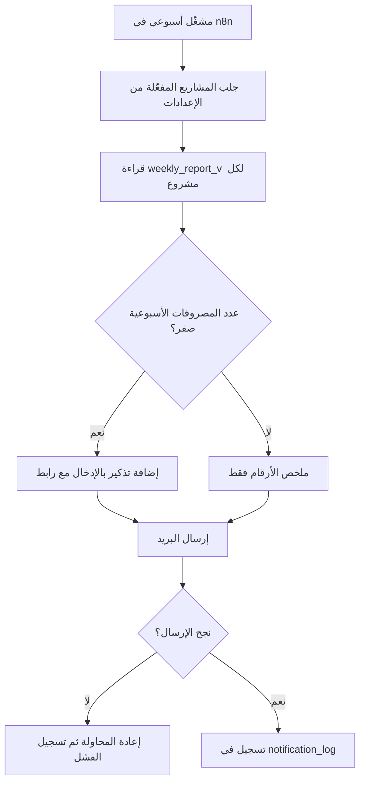
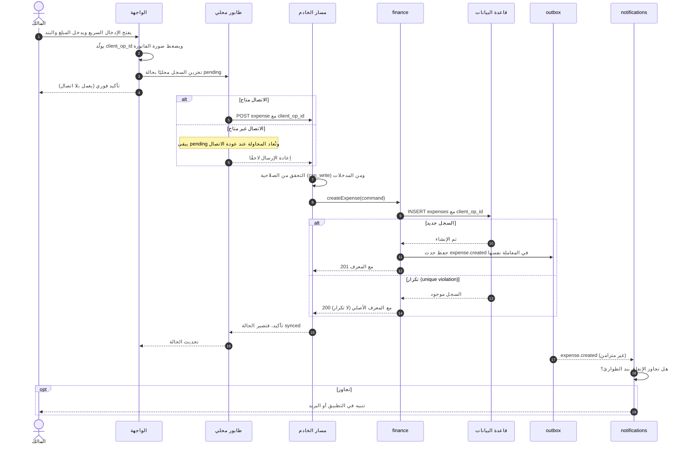
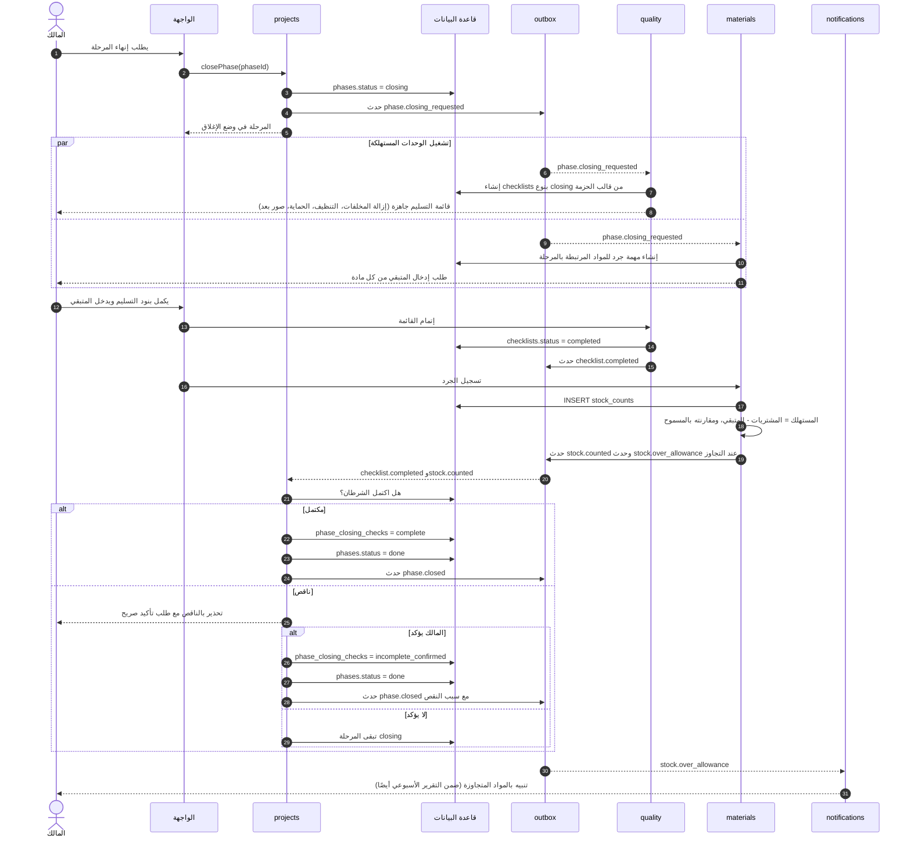
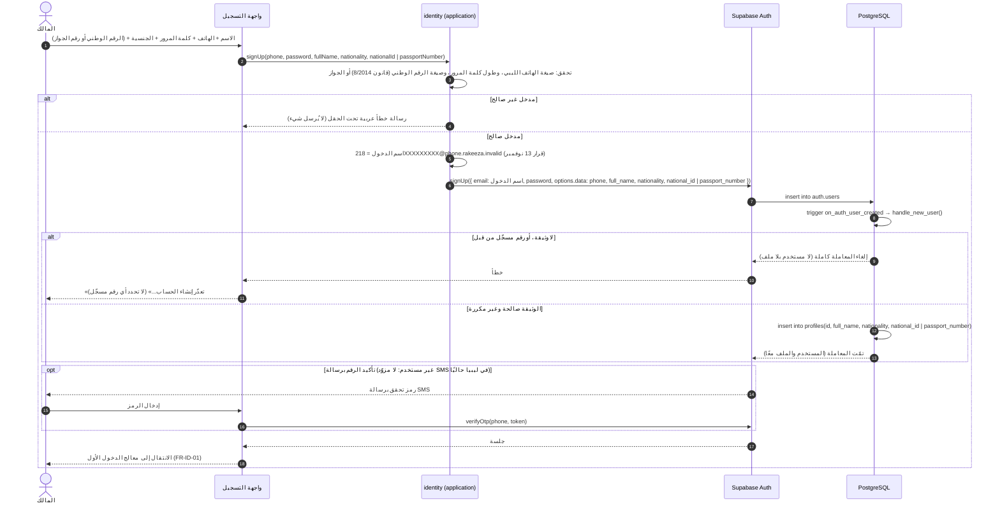

# التحليل والتصميم: حالات الاستخدام والمخططات

**المرحلة:** 20–27 أكتوبر 2026 (مرحلة التحليل والتصميم حسب القسم 7 من المرجع)
**المرجع:** `graduation_project_master_reference.md`، `system_architecture.md`، `schema.sql`
**الحالة:** مسودة للمراجعة الداخلية. تُعرض المخططات كنص Mermaid، ويمكن لصقها في mermaid.live لرؤيتها كصور.

---

## 1. الفاعلون (Actors)

| الفاعل | الوصف | الصلاحية |
|---|---|---|
| **المالك** | صاحب المنزل، المستخدم الأساسي | كاملة على مشاريعه |
| **عضو المشروع** | أحد أفراد الأسرة أو الشريك المشارك في الإدخال | تحدده المالك (إدخال، أو قراءة) |
| **المستلم بالمشاركة** | مهندس أو مقاول يطّلع عبر رابط مؤقت | قراءة فقط، ضمن نطاق التقرير |
| **المراجع الهندسي** | مهندس يراجع قوائم الفحص وقاعدة المعرفة | قراءة قاعدة المعرفة وتعليق كتابي خارج النظام |
| **جدولة n8n** | نظام آلي يرسل التقرير الأسبوعي | قراءة عرض `weekly_report_v` فقط |
| **المساعد الذكي** | يشرح المراحل والحسابات | قراءة فقط من قاعدة المعرفة المعتمدة وبيانات المالك |
| **مدير النظام** | يفعل الميزات ويراقب الأعطال | إعدادات `feature_flags` وسجلات التدقيق |

---

## 2. كتالوج حالات الاستخدام

| الرقم | حالة الاستخدام | الفاعل الرئيسي | الميزة | الأولوية |
|---|---|---|---|---|
| UC-01 | التسجيل وتسجيل الدخول | المالك | 3.11 | 0 |
| UC-02 | إنشاء مشروع وتحديد نوعه (جديد أو إضافة طابق) | المالك | 3.1 | 0 |
| UC-03 | إدارة المراحل (تاريخ مخطط وفعلي وحالة) | المالك | 3.1 | 0 |
| UC-04 | إدارة المهام | المالك، عضو | 3.1 | 0 |
| UC-05 | دعوة عضو وتحديد صلاحيته | المالك | 3.11 | 0 |
| UC-06 | تحديد الميزانية وبنود الطوارئ | المالك | 3.2 | 0 |
| UC-07 | تسجيل مصروف سريع (3 نقرات وصورة فاتورة) | المالك، عضو | 3.19 | 0 |
| UC-08 | تسجيل مصروف بعملة أجنبية وسعر صرف مرجعي | المالك | 3.18 | 1 |
| UC-09 | إدخال جدول الكميات مرة واحدة | المالك، المراجع | 3.9 | 2 |
| UC-10 | تسجيل شراء مادة وربطه بالكمية المخططة | المالك، عضو | 3.9 | 1 |
| UC-11 | تسجيل سعر أو عرض سعر لمادة | المالك | 3.10 | 2 |
| UC-12 | حساب كميات الحديد من جدول التفريد | المالك | 3.3 | 1 |
| UC-13 | مقارنة الاستمرار بالتوقف المؤقت | المالك | 3.7 | 1 |
| UC-14 | رفع صورة موثّقة بزاوية وربطها بمرحلة | المالك، عضو | 3.8 | 4 |
| UC-15 | إضافة وثيقة أو عقد أو تصريح | المالك | 3.4 | 0 |
| UC-16 | تسجيل دفعة مرتبطة بمرحلة وعقد | المالك | 3.16 | 1 |
| UC-17 | تسجيل أعمال إضافية وأثرها على الميزانية | المالك | 3.16 | 1 |
| UC-18 | تشغيل قائمة فحص قبل الصب أو التغطية | المالك، المراجع | 3.12 | 2 |
| UC-19 | تسجيل خرسانة (تاريخ الصب، المورد، الكمية) | المالك | 3.13 | 2 |
| UC-20 | الإبلاغ عن عيب بصورة وموقع ومسؤول | المالك، عضو | 3.17 | 2 |
| UC-21 | إنهاء مرحلة عبر قائمة التسليم والجرد الختامي | المالك | 3.23 | 2 |
| UC-22 | التحقق من بوابة الجاهزية قبل البدء | المالك | 3.15 | 2 |
| UC-23 | تحديد نقاط التوقف الآمنة لمرحلة | المالك | 3.14 | 2 |
| UC-24 | تطبيق حزمة أعمال تشطيب على مرحلة | المالك | 3.22 | 2 |
| UC-25 | طلب شرح مرحلة من المساعد | المالك، عضو | 3.6 | 3 |
| UC-26 | تفعيل التقرير الأسبوعي وتحديد يومه وقناته | المالك | 3.21 | 3 |
| UC-27 | استلام التقرير الأسبوعي | المالك، المستلم | 3.21 | 3 |
| UC-28 | مشاركة تقرير بالقراءة فقط برابط مؤقت | المالك | 3.11 | 2 |
| UC-29 | عرض لوحة التحكم | الكل حسب الصلاحية | 3.5 | 0 |
| UC-30 | مراجعة قاعدة المعرفة الهندسية | المراجع الهندسي | 3.6 | 3 |
| UC-31 | تعطيل ميزة أو تفعيلها | مدير النظام | 5 | 0 |
| UC-32 | تسجيل العمل بلا اتصال ومزامنته | المالك، عضو | 3.20 | 3 |

**ملاحظة على UC-14:** صنّفنا تحليل الصور بالذكاء الاصطناعي كمستبعد، لذلك UC-14 توثيق منظم بزوايا محددة فقط.

---

## 3. مخطط حالات الاستخدام (الفاعلون والحالات الرئيسية)

---

## 4. مخططات الأنشطة للإجراءات الحرجة

### 4.1 الإدخال السريع للمصروف (UC-07)

### 4.2 إنهاء مرحلة (UC-21، إعادة تصميم وفق 3.23)

### 4.3 بوابة الجاهزية قبل البدء (UC-22)

### 4.4 التقرير الأسبوعي عبر n8n (UC-27)

---

## 5. مخطط الكيانات والعلاقات (ERD) — الإصدار 2

يعكس التعديلات في القسم 13 من `system_architecture.md`: عضوية المشروع، والحالة `closing`، وجرد المواد، وإزالة مفتاح `purchases.expense_id`، والجداول التقنية (outbox وaudit وfeature_flags). يرمز `ref` إلى مرجع ضعيف (معرّف بلا مفتاح خارجي) عبر الوحدات.

```mermaid
erDiagram
  PROFILES ||--o{ PROJECT_MEMBERS : "عضوية"
  PROJECTS ||--o{ PROJECT_MEMBERS : "يضم"
  PROJECTS ||--o{ PHASES : "يتكون من"
  PROJECTS ||--o{ TASKS : "يحوي"
  PROJECTS ||--o{ BUDGET_CATEGORIES : "ميزانية"
  PROJECTS ||--o{ EXPENSES : "مصروفات"
  PROJECTS ||--o{ EXCHANGE_RATES : "أسعار صرف"
  PROJECTS ||--o{ QUANTITY_ITEMS : "كميات"
  PROJECTS ||--o{ PRICE_RECORDS : "أسعار"
  PROJECTS ||--o{ PHOTOS : "صور"
  PROJECTS ||--o{ CONTRACTS : "عقود"
  PROJECTS ||--o{ CHECKLISTS : "قوائم فحص"
  PROJECTS ||--o{ ISSUES : "عيوب"
  PROJECTS ||--o{ DOCUMENTS : "وثائق"
  PROJECTS ||--o{ SHARED_REPORTS : "مشاركات"
  PROJECTS ||--o{ NOTIFICATION_SETTINGS : "إعدادات تقرير"
  PROJECTS ||--o{ PHASE_CLOSING_CHECKS : "إغلاق"
  PROJECTS ||--o{ DECISION_SCENARIOS : "قرارات"

  PHASES ||--o{ TASKS : "مهام"
  PHASES ||--o{ CHECKLISTS : "قوائم"
  PHASES ||--o{ PHOTOS : "صور"
  PHASES ||--o{ PHASE_CLOSING_CHECKS : "إغلاق"
  PHASES ||--o{ EXPENSES : "ربط اختياري"

  BUDGET_CATEGORIES ||--o{ EXPENSES : "تصنيف"
  CONTRACTS ||--o{ PAYMENTS : "دفعات"
  CONTRACTS ||--o{ CHANGE_ORDERS : "أعمال إضافية"
  PHASES ||--o{ PAYMENTS : "ربط اختياري"

  QUANTITY_ITEMS ||--o{ PURCHASES : "مشتريات"
  QUANTITY_ITEMS ||--o{ STOCK_COUNTS : "جرد"
  PHASES ||--o{ QUANTITY_ITEMS : "ربط اختياري"
  EXPENSES ||--o| PURCHASES : "ref"
  PURCHASES }o--|| PROJECTS : "ref"

  CHECKLISTS ||--o{ CHECKLIST_ITEMS : "بنود"
  CHECKLISTS ||--o{ ISSUES : "ref"
  TRADE_TEMPLATES ||--o{ CHECKLISTS : "يُنشئ"
  KB_ENTRIES ||--o{ CHECKLISTS : "مرجع"

  PROFILES {
    uuid id PK
    text full_name
    text nationality "libyan | foreign (0005)"
    text national_id UK "12 رقمًا، لليبي فقط (0005)"
    text passport_number UK "لغير الليبي فقط (0005)"
    timestamptz created_at
  }
  PROJECTS {
    uuid id PK
    uuid owner_id FK
    text name
    text project_type
    numeric total_budget_lyd
    numeric contingency_pct
    bool weekly_report_enabled
    text status
  }
  PROJECT_MEMBERS {
    uuid project_id PK
    uuid user_id PK
    text role
  }
  SHARED_REPORTS {
    uuid id PK
    uuid project_id FK
    text token_hash
    timestamptz expires_at
    bool revoked
  }
  PHASES {
    uuid id PK
    uuid project_id FK
    int position
    text status
    date planned_end
    date actual_end
  }
  PHASE_CLOSING_CHECKS {
    uuid id PK
    uuid phase_id FK
    text result
    bool confirmed_by_owner
    timestamptz created_at
  }
  TASKS {
    uuid id PK
    uuid project_id FK
    uuid phase_id FK
    text status
  }
  BUDGET_CATEGORIES {
    uuid id PK
    uuid project_id FK
    numeric planned_lyd
    bool is_contingency
  }
  EXPENSES {
    uuid id PK
    uuid project_id FK
    uuid category_id FK
    uuid phase_id FK
    numeric amount_lyd
    numeric original_amount
    text original_currency
    date paid_on
    text receipt_path
    text client_op_id
  }
  EXCHANGE_RATES {
    uuid id PK
    uuid project_id FK
    text currency
    numeric lyd_per_unit
    date rate_date
  }
  CONTRACTS {
    uuid id PK
    uuid project_id FK
    text contractor
    numeric value_lyd
  }
  PAYMENTS {
    uuid id PK
    uuid contract_id FK
    uuid phase_id FK
    numeric amount_lyd
    bool withheld
    date paid_on
  }
  CHANGE_ORDERS {
    uuid id PK
    uuid contract_id FK
    numeric cost_lyd
    text status
  }
  QUANTITY_ITEMS {
    uuid id PK
    uuid project_id FK
    uuid phase_id FK
    text material
    text unit
    numeric planned_qty
    text verified_by
  }
  PURCHASES {
    uuid id PK
    uuid project_id FK
    uuid quantity_item_id FK
    numeric qty
    numeric unit_price_lyd
    date purchased_on
    text client_op_id
  }
  STOCK_COUNTS {
    uuid id PK
    uuid quantity_item_id FK
    uuid phase_id FK
    numeric remaining_qty
    timestamptz counted_at
  }
  PRICE_RECORDS {
    uuid id PK
    uuid project_id FK
    text material
    numeric price_lyd
    bool is_quote
    date quote_expires_on
  }
  PHOTOS {
    uuid id PK
    uuid project_id FK
    uuid phase_id FK
    text angle_label
    text storage_path
    date taken_on
  }
  CHECKLISTS {
    uuid id PK
    uuid project_id FK
    uuid phase_id FK
    uuid template_id FK
    text kind
    text status
    timestamptz completed_at
  }
  CHECKLIST_ITEMS {
    uuid id PK
    uuid checklist_id FK
    text text
    text result
    bool requires_photo
  }
  ISSUES {
    uuid id PK
    uuid project_id FK
    uuid checklist_id FK
    text kind
    text severity
    text status
    text location
    text responsible
  }
  DOCUMENTS {
    uuid id PK
    uuid project_id FK
    text kind
    text storage_path
  }
  TRADE_TEMPLATES {
    uuid id PK
    text trade
    text status
    text reviewed_by
    date reviewed_on
    bool is_reviewed
  }
  KB_ENTRIES {
    uuid id PK
    text topic
    text status
    text reviewed_by
    date reviewed_on
  }
  DECISION_SCENARIOS {
    uuid id PK
    uuid project_id FK
    text choice
    numeric result_lyd
  }
  NOTIFICATION_SETTINGS {
    uuid project_id PK
    bool enabled
    text weekday
    text channel
  }
  NOTIFICATION_LOG {
    uuid id PK
    uuid project_id FK
    timestamptz sent_at
    text status
  }
  OUTBOX_EVENTS {
    uuid id PK
    text event_type
    jsonb payload
    timestamptz processed_at
  }
  AUDIT_LOG {
    uuid id PK
    uuid actor_id
    text table_name
    text action
    timestamptz at
  }
  FEATURE_FLAGS {
    text module PK
    bool enabled
  }
```

**ملاحظات على الـERD:**
- `EXPENSES.phase_id` و`PAYMENTS.phase_id` و`QUANTITY_ITEMS.phase_id` اختيارية، لتسمح بتسجيل المال دون ربط بمرحلة.
- `PURCHASES` لا يحمل مفتاحًا خارجيًا نحو `EXPENSES`؛ الربط يتم بحدث `purchase.recorded` كما في القسم 6 من المعمارية.
- `client_op_id` على الجداول التي يكتب فيها المستخدم بلا اتصال (3.20)، ويُفرض فريدًا لكل مشروع لمنع التكرار.
- `OUTBOX_EVENTS` و`AUDIT_LOG` و`FEATURE_FLAGS` جداول تقنية تملكها `shared-kernel`.
- كيانات `TRADE_TEMPLATES` وKB_ENTRIES تحمل حقول المراجعة (من ولماذا وتاريخ) ولا تُعرض للمستخدم إلا إذا كانت مراجعة.

### تحديث ERD (الإصدار 2.1، ترحيل 0002)

أُضيفت بعد كتابة المتطلبات الكيانات التالية، وهي غير مرسومة في المخطط أعلاه:

| الكيان | الوحدة | الغرض | المتطلب |
|---|---|---|---|
| OBLIGATIONS | finance | الالتزامات والديون وتاريخ استحقاقها | FR-FIN-06 |
| EXPECTED_INCOME | finance | الدخل المتوقع وتوقيته | FR-FIN-07 |
| CONCRETE_POURS | quality | سجل الخرسانة المهيكل (الموقع، الكمية، المورد، عينات المكعبات) | FR-QLT-04 |

وتغيّرت أيضًا: حالات العيب صارت مفتوح وقيد المعالجة ومغلق، وأُضيف نوع قائمة «جاهزية»، وأُضيف حقل تكلفة النقل إلى سجل الأسعار. الكيانات الثلاثة ترتبط بالمشروع، وCONCRETE_POURS ترتبط اختياريًا بالمرحلة وبقائمة الفحص.

---

## 6. مصفوفة التتبع: الميزة ← حالة الاستخدام ← الجدول ← الوحدة

| الميزة | حالات الاستخدام | الجداول الرئيسية | الوحدة |
|---|---|---|---|
| 3.1 المشاريع والمراحل | UC-02، 03، 04 | projects، phases، tasks | projects |
| 3.2 الميزانية | UC-06، 07 | budget_categories، expenses | finance |
| 3.3 حاسبات الكميات | UC-12 | quantity_items | materials |
| 3.4 الوثائق | UC-15 | documents | documents |
| 3.5 لوحة التحكم | UC-29 | عروض قراءة | dashboard |
| 3.6 المساعد | UC-25، 30 | kb_entries | knowledge |
| 3.7 الاستمرار أو التوقف | UC-13 | decision_scenarios | decisions |
| 3.8 توثيق الصور | UC-14 | photos | documents |
| 3.9 جدول الكميات | UC-09، 10 | quantity_items، purchases | materials |
| 3.10 سجل الأسعار | UC-11 | price_records | materials |
| 3.11 الحسابات والصلاحيات | UC-01، 05، 28 | profiles، project_members، shared_reports | identity |
| 3.12 نقاط التفتيش | UC-18 | checklists، checklist_items | quality |
| 3.13 سجل الخرسانة | UC-19 | checklists (kind = concrete) | quality |
| 3.14 نقاط التوقف الآمنة | UC-23 | checklists | quality |
| 3.15 بوابة الجاهزية | UC-22 | projects، audit_log | projects |
| 3.16 العقود والدفعات | UC-16، 17 | contracts، payments، change_orders | finance |
| 3.17 العيوب | UC-20 | issues | quality |
| 3.18 العملة | UC-08 | exchange_rates | finance |
| 3.19 الإدخال السريع | UC-07 | expenses | finance |
| 3.20 بلا اتصال | UC-32 | client_op_id | shared-kernel |
| 3.21 التقرير الأسبوعي | UC-26، 27 | notification_settings، notification_log | notifications |
| 3.22 حزم التشطيب | UC-24 | trade_templates | trades |
| 3.23 تسليم المرحلة | UC-21 | phase_closing_checks، stock_counts | projects، quality، materials |

---

## 7. ما يتبقى في هذه المرحلة

1. مراجعة الكيانات مع المراجع الهندسي (لا تُستخدم أرقام القيم حتى تُعتمد).
2. تحديث `schema.sql` إلى الإصدار 2 وفق هذا الـERD، وتشغيله على PostgreSQL المحلي كما فُعل سابقًا.
3. مخطط تسلسل (Sequence) لـUC-07 وUC-21 للوحدات والأحداث.
4. ~~اختيار التقنية النهائية~~ تم (28 أكتوبر 2026): القرارات A8 وA9 وA11 في المعمارية.

---

## 8. مخطط التسلسل: UC-07 تسجيل مصروف سريع (مع العمل بلا اتصال)

القاعدة هنا: الواجهة تكتب محليًا أولًا، ثم ترسل الطلب مع `client_op_id` فيصير الإرسال المكرر آمنًا. والمالية (L2) تُنشئ المصروف وتصدر حدثًا، ولا تستدعيها الوحدات الأخرى مباشرة.

**ملاحظات على UC-07:**
- الصورة تُضغط في المتصفح قبل التخزين المحلي، لأن حجم الصورة الكامل قد يتجاوز الذاكرة المحلية.
- التكرار لا يُنشئ سجلًا ثانيًا، ويعيد المعرف الأصلي، فلا تتضاعف المصروفات بإعادة الإرسال.
- التنبيه بتجاوز الميزانية غير متزامن، فلا يبطئ التسجيل.
- إن رُفض الطلب بخطأ تحقق (مثل مبلغ صفر) يبقى السجل المحلي بحالة `rejected` ويظهر للمالك ليصححه، ولا يُحذف صامتًا.

---

## 9. مخطط التسلسل: UC-21 إنهاء مرحلة (وفق 3.23 والوحدات المعزولة)

القاعدة هنا: `projects` (L1) لا تستدعي `quality` ولا `materials` (L2) مباشرة. تبدأ الأوامر بطلب إغلاق، وتعود النتائج بأحداث، فتقرر `projects` في النهاية.

**ملاحظات على UC-21:**
- كل وحدة تنشئ ما يخصها عند استلام الحدث، فلا يعرف `projects` تفاصيل التنظيف أو الجرد، ويعرف فقط هل اكتمل الشرطان.
- التأخر في أي وحدة لا يوقف الأخرى. الحدث ينتظر في `outbox` حتى يعالجه المستهلك، وإعادة المعالجة لا تضر لأن المستهلك مصمم ليكون idempotent.
- القرار النهائي بيد المالك دائمًا، فلا يمنع النظام الإغلاق آليًا (القرار D2).
- إن غابت قائمة التسليم أو الجرد، لا تُحذف المرحلة من الجدول، بل تبقى `closing` وتظهر في التقرير الأسبوعي (3.21).

---

## 10. ما تم في هذه المرحلة وما تبقى

- **تم:** حالات الاستخدام، ومخططات الأنشطة، وERD الإصدار 2 (مطبّق في `schema.sql`)، ومخططات التسلسل لـUC-07 وUC-21.
- **يتبقى:** مراجعة المخططات مع المراجع الهندسي فيما يخص قوائم التسليم، والقرارات الخمس لمراجعة المخططات (لم تُحسم)، ومخططات الواجهات والمتطلبات المرقّمة. أما التقنية فقد حُسمت (A8 وA9 وA11).

---

## 11. مخطط التسلسل: UC-01 التسجيل برقم الهاتف وكلمة المرور (ترحيل 0003، 12 نوفمبر 2026)

القاعدة هنا: لا يوجد مستخدم بلا ملف شخصي. Supabase Auth يضيف المستخدم إلى `auth.users`، وفي المعاملة نفسها يُنشئ الـtrigger `on_auth_user_created` سجله في `profiles`. لذلك لا يحتاج التطبيق إلى جلسة مفتوحة لإنشاء الملف، وهذا مهم لأن التسجيل مع تأكيد الرقم لا يعيد جلسة.

**ملاحظات على UC-01:**
- الدالة `handle_new_user` تعمل بصلاحية مالكها (`security definer`) لأن المستخدم الجديد لا يملك بعد حق الكتابة في `profiles`، و`search_path` فارغ وكل الأسماء مؤهلة بالمخطط، فلا يمكن خداعها بكائن بالاسم نفسه.
- الاسم يأتي من بيانات التسجيل، ويُحذف ما حوله من مسافات، والاسم الفارغ يُخزَّن `null`.
- **وثيقة الهوية (FR-ID-06، ترحيل 0005):** الليبي يُدخل الرقم الوطني، وغير الليبي رقم الجواز، ويُحفظ الرقم المطابق للجنسية فقط. لا يمكن تجاوز النموذج باستدعاء Supabase مباشرة، لأن الـtrigger نفسه يرفض التسجيل بلا وثيقة. والرقم مكتوب مرة واحدة: يستطيع المستخدم تعديل اسمه فقط (صلاحيات أعمدة). ولا يراه أحد غير صاحبه، لا أعضاء المشروع ولا التقارير.
- رسالة رفض الرقم المكرر لا تذكر أي رقم مسجّل، حتى لا يُستخدم النموذج للتحقق من أرقام الآخرين.
- حذف المستخدم من `auth.users` يحذف ملفه تلقائيًا (`on delete cascade`).
- `profiles` خاص بصاحبه: لا يقرأ المستخدم ولا يعدّل إلا ملفه (سياسة `own_profile`)، وهذا مختبَر في `tests/db/rls_0003.test.sql`.
- لا كيان جديد في ERD: الترحيل يضيف دالة وtrigger فقط.
